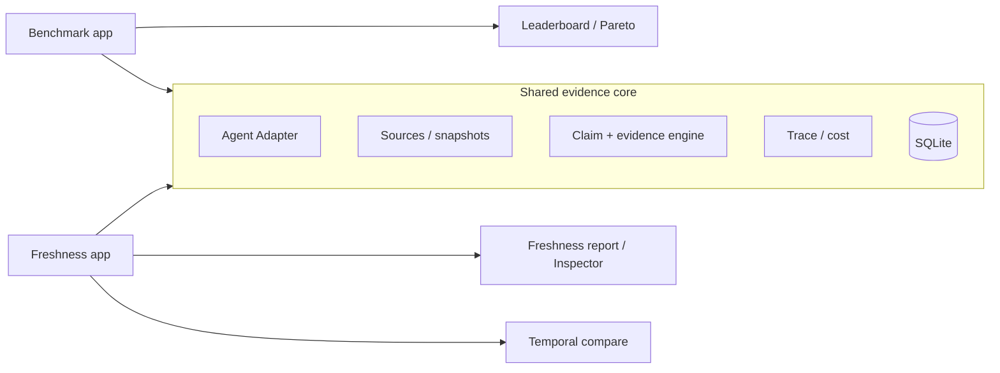

# YAI Scout

**Evidence-first research agent + freshness-aware agent benchmark.**
Two independent hackathon projects sharing one evidence core.

[](https://github.com/Gi-Tuu/yai-scout/actions/workflows/ci.yml)
[](https://github.com/Gi-Tuu/yai-scout/releases)
[](LICENSE)
[](pyproject.toml)

> *We benchmark not just whether agents are right, but whether their evidence is still current.*

---

## The two projects

| Project | Track | Problem statement | What it does |
|---|---|---|---|
| **[YAI Scout Benchmark](docs/charter-benchmark.md)** | Bifrost — Problem 02 | Build a benchmarking platform for AI agents, not just models | Runs different agent architectures on one dataset; ranks accuracy, **freshness**, evidence quality, cost and latency |
| **[YAI Scout Freshness](docs/charter-freshness.md)** | Tavily — Problem 01 | Stale-answer detector | Splits any LLM answer into claims, verifies each against live sources, returns Freshness Score + evidence + correction |

Both are independent deliverables (separate entry points, README, tests and demo), sharing one **evidence core**:
claim extraction, source validation, freshness scoring, snapshot store and execution trace.

## Quick start

```bash
# 1) install
uv sync --extra dev

# 2) keys (optional: falls back to keyless Tavily / rule-based extraction)
cp .env.example .env    # fill TAVILY_API_KEY / OPENAI_API_KEY

# 3) run
uv run uvicorn yai_scout.api.app:app --port 8010
```

| URL | Purpose |
|---|---|
| `http://127.0.0.1:8010/` | landing: choose a project |
| `/benchmark` | multi-agent leaderboard, Pareto frontier, 24-task dataset |
| `/freshness` | paste an LLM answer → claim-level freshness report |
| `/inspector` | evidence inspector: claims, sources, score breakdown |
| `/compare` | temporal drift between two reports (real replay when snapshots exist) |

Docker (verified locally):

```bash
docker compose up -d --build
# benchmark → http://127.0.0.1:8010
# freshness → http://127.0.0.1:8011
```

## Architecture



## What is real today (2026-11-01)

| Capability | Status |
|---|---|
| Claim extraction | LLM (JSON mode, quote-substring validated) + rule fallback |
| Live verification | Tavily search, 4-source relation analysis (supports / contradicts / mentions) |
| Freshness model | temporal-sensitivity classes (stable/slow/sensitive/volatile), decision table, explainable score breakdown, confidence |
| Benchmark | 24 tasks (21 public + 3 hidden), four categories; report categories stable / time-sensitive / changed / conflicting |
| Agent adapters | HTTP `scout-adapter/1.0`, Python in-process, CLI subprocess, plus reference agents |
| Ranking | multi-dimensional table + non-dominated Pareto frontier |
| Evidence inspector | claim → sources → timestamps → relation → score breakdown → suggestion |
| Temporal replay | **real**: GitHub Releases official history; example: YAI version `0.25.0` is **STALE at 2026-10-28** and **FRESH at 2026-11-01** |
| Deployment | `Dockerfile` + two-container compose, `SCOUT_MODE` isolation verified |
| Quality gates | 73 tests, ruff, mypy strict; CI runs lint + types + tests + Docker build |

## Honest limits

- Web-archive history is **not** available from the current network (archive.org unreachable); replay uses GitHub release history and must be labelled `simulated` when no snapshot exists. We never fake historical evidence.
- The freshness calibration set has 20 rule-labelled claims (status 20/20, MAE 12.06); human scoring of 60 claims is pending.
- The benchmark dataset is intentionally small and scoped to the AI-developer ecosystem; it is a demo benchmark, not an academic leaderboard.
- LLM/API keys are **not** stored in this repo; runs without keys fall back to keyless/rule-based modes.

## AI usage (for judges)

AI is used at bounded joints: claim extraction, relation judgement, correction suggestions and answer synthesis. Deterministic code owns the pipeline, budgets, evidence storage, status decisions and scoring. Every AI output is schema-checked; extracted quotes must be exact substrings of the source; scores are computed by fixed formulas (no LLM-generated score).

## Repository map

```text
src/yai_scout/
  detector/        claim extraction, temporal classification, verification, freshness scoring, compare
  benchmark/       dataset, adapters, runner, scoring, protocol
  retrieval/       Tavily client, URL canonicalization, source tiers
  sources/         snapshots (Wayback / manual / GitHub history), snapshot search
  pipeline/        research console pipeline (legacy /research entry)
  store.py         SQLite store
  api/app.py       FastAPI app: /benchmark, /freshness, /inspector, /compare
web/static/        landing, benchmark, freshness, inspector, compare pages
benchmarks/        tasks.json (24 tasks), labeled_claims.json (20 claims)
examples/          external agents: echo (HTTP), python, CLI
docs/              charters, specs, evaluation, demo script
```

## Documentation

- [Project charters](docs/charter-benchmark.md) · [Freshness charter](docs/charter-freshness.md)
- [Differentiation spec](docs/differentiation-spec.md) · [Freshness scoring spec](docs/spec-freshness-scoring.md)
- [Adapter & dataset spec](docs/spec-benchmark-adapter.md) · [Temporal replay spec](docs/spec-temporal-replay.md)
- [Evaluation](docs/freshness-eval.md) · [Demo script](docs/demo-script.md) · [Hackathon rules report](docs/hackathon-rules-report.md)
- [YAI reuse & license audit](docs/yai-reuse.md) · [API resources](docs/api-resources.md)

## License

MIT — see [LICENSE](LICENSE) and [NOTICE](NOTICE) for reused components (YAI Agent Core v0.25.0, MIT).

