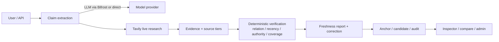

# YAI Scout

**Evidence-first stale-answer detector.** Audit an existing LLM answer claim by claim, verify it against current sources, and show what is still true, what changed, and what cannot be verified.

[](https://github.com/Gi-Tuu/yai-scout/actions/workflows/ci.yml)
[](https://github.com/Gi-Tuu/yai-scout/releases)
[](LICENSE)
[](pyproject.toml)

**Live demo:** <https://yai-scout.onrender.com/freshness>  
Free tier sleeps after ~15 min idle; first request can take 30–90s. 32 real GitHub-release snapshots ship in the image, so replay works without setup.

---

## The problem

LLM answers often look cited but cite **old pages**. Grounding and citation checks answer "is this supported by evidence", not "is the evidence still current, and what is the value today".

YAI Scout is a **post-hoc audit layer**:

```text
answer → claims → temporal sensitivity → current-source research
       → FRESH / STALE / CONFLICTED / INSUFFICIENT / UNKNOWN per claim
       → current value + correction + evidence links
```

## What is different

1. **Post-hoc**: audit answers from any model; no need to rebuild the RAG or agent.
2. **Support ≠ freshness**: evidence can fully support a claim that is already outdated.
3. **Current value + correction**, not just a red/green status.
4. **As-of replay**: the same answer is fresh at 2026-10-28 and stale at 2026-11-01 using real GitHub release history.
5. **Evidence governance**: anchors, multi-source candidates, an accuracy gate, approve/reject and rollback — automated updates stay auditable instead of overwriting silently.

## Technology roles

| Component | Role | Where |
|---|---|---|
| **Tavily** | live research: current sources, source content, recency and tier signals | `retrieval/tavily.py`, detector verification |
| **Controlled page fetch** | optional, allowlisted HTTPS fetch of a result page; default off | `sources/page.py`, `sources/anchor.py` |
| **Bifrost** | OpenAI-compatible model gateway: claim extraction, relation assessment, correction rewrite; provider routing and logs | `llm.py`, `docs/bifrost-integration.md` |
| Deterministic code | status decisions, budgets, evidence storage, scoring, audit | `detector/`, `store.py` |

Bifrost is an optional gateway. When `BIFROST_BASE_URL` is set, model requests go through Bifrost. Without it, the app uses a direct OpenAI-compatible endpoint. The public demo is configured with Bifrost; the direct path remains available for offline/keyless runs. The live gateway can be checked at `/api/healthz` (`llm.gateway`).

## Quick start

```bash
uv sync --extra dev
cp .env.example .env
# fill TAVILY_API_KEY
# optional Bifrost gateway:
#   scripts/start_bifrost.ps1   # or: docker run -p 8080:8080 maximhq/bifrost
# fill BIFROST_BASE_URL / BIFROST_MODEL
uv run uvicorn yai_scout.api.app:app --port 8010
```

Run the configured quality gates with one command:

```bash
python scripts/check_all.py
```

| URL | Purpose |
|---|---|
| `/freshness` | paste an LLM answer → claim-level freshness report |
| `/inspector` | claims → sources → timestamps → score breakdown |
| `/compare` | temporal drift between two reports (real replay) |
| `/benchmark` | evaluation: 40 tasks, multiple agents, Pareto |
| `/label` | blind accuracy labeling |
| `/admin` | token-gated candidates / approve / reject / rollback |

## Fixed replay demo

```powershell
# deterministic offline replay from cached real API responses
.\.venv\Scripts\python.exe scripts\demo_fixed_cases.py

# live check
.\.venv\Scripts\python.exe scripts\demo_fixed_cases.py --check `
  --url https://yai-scout.onrender.com
```

Fixed cases:

```text
Python 3.12 (2023)        FRESH   stable fact, old source is fine
YAI 0.24.0 @ 2026-10-28   FRESH   correct at the time
YAI 0.24.0 @ 2026-11-01   STALE   citation ≠ freshness
YAI 0.25.0 @ 2026-11-01   FRESH   current value
```

## Architecture



## Current capabilities

| Capability | Status |
|---|---|
| Claim extraction | LLM via Bifrost/direct or rule fallback; quote-substring validated |
| Live verification | Tavily search; supports / contradicts / mentions relation |
| Freshness model | temporal sensitivity classes, versioned policy and weights, explainable breakdown |
| Evidence provenance | published / updated / retrieved times kept distinct; full-page fetch preserves search metadata |
| Claim identity | typed v1/v2 keys with additive migration and dual-read fallback |
| Bifrost integration | configurable OpenAI-compatible gateway; `healthz` reports the active gateway |
| Temporal replay | GitHub release snapshots: 2026-10-28 FRESH vs 2026-11-01 STALE |
| Evidence governance | anchors, multi-source candidates, accuracy gate, approve/reject/rollback |
| Benchmark | 40 tasks, HTTP/Python/CLI adapters, repeated runs, failure injection, step/tool traces, Pareto, manifest + `result_hash` |
| Verdict evaluation | claim-level Freshness status suite; no Tavily/LLM; precision/recall/confusion |
| Quality gates | 382 tests on Python 3.11/3.12, ruff, mypy strict, CI + Docker |

## Integration surfaces

`POST /freshness/verify` and `POST /api/detector` return:

```text
X-Freshness-Status       first claim status
X-Freshness-Statuses     all claim statuses
X-Freshness-Score        overall score
X-Freshness-Report-ID
X-Freshness-Report-URL  public read-only share page
```

The share page is `/freshness/share/{report_id}` and is `noindex`.
For agent integration, `python scripts/mcp_freshness.py` exposes the same check
as a stdio MCP tool (`freshness_check`). `scripts/demo_showcase_cases.py --check`
runs the six showcase cases against a deployed instance.
`scripts/async_freshness_queue.py` runs those cases through a bounded client-side
worker pool; the six source cases live in `benchmarks/showcase_cases.jsonl`.

## Honest limits

- Human labels are **rule-following**, not an independent ground truth; `AUTO_UPDATE` stays **off**.
- Web-archive history is unavailable in the current environment; replay uses GitHub release history and is labelled `simulated` when no snapshot exists. Historical evidence is never fabricated.
- The benchmark is a small evaluation suite, not an academic leaderboard.
- Bifrost is verified locally and used by the public demo; the direct path is used when no gateway is configured. `healthz.llm.gateway` reports the active route.
- LLM/Tavily keys are not in this repo; keyless and rule-based fallbacks exist.


## Feedback

Bugs and questions: <https://github.com/Gi-Tuu/yai-scout/issues>

## Documentation

- [Bifrost integration](docs/bifrost-integration.md) · [Bifrost verification](docs/bifrost-verification.md)
- [Benchmark reliability](docs/benchmark-reliability.md) · [Benchmark retention](docs/benchmark-retention.md) · [Benchmark session state](docs/benchmark-session-state.md) · [Performance smoke](docs/performance-smoke.md) · [Staging load test](docs/staging-load-test.md) · [Storage layout](docs/storage-layout.md) · [Verify/relation layout](docs/verify-relation-layout.md) · [External benchmark](docs/external-benchmark.md) · [External v2](docs/external-benchmark-v2.md) · [Freshness verdict evaluation](docs/freshness-verdict-eval.md)
- [Claim key versioning](docs/claim-key-versioning.md)
- [Full-page fetch](docs/full-page-fetch.md)
- [Freshness scoring](docs/spec-freshness-scoring.md) · [Temporal replay](docs/spec-temporal-replay.md)
- [Anchor retrieval](docs/spec-anchor-retrieval.md) · [Accuracy gate](docs/spec-accuracy-gate.md) · [Accuracy eval](docs/accuracy-eval.md)
- [Database operations](docs/db-operations.md) · [Migration plan](docs/db-migration-plan.md)
- [Deployment](docs/deploy-free.md) · [XFF diagnosis](docs/xff-diagnosis.md)
- [Governance](docs/governance/engineering-governance-v1.md) · [ADR-0003](docs/adr/0003-engineering-governance.md)
- [Engineering audit](docs/audit-2026-11-02.md) · [Changelog](CHANGELOG.md)

## License

MIT — see [LICENSE](LICENSE) and [NOTICE](NOTICE) for reused components (YAI Agent Core v0.25.0, MIT).
