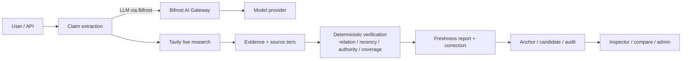

# YAI Scout

**Evidence-first stale-answer detector.** Audit any LLM answer claim by claim, verify it against live sources, and show what is still true, what changed, and what cannot be verified.

**Primary submission: Tavily Track — Problem 05, Stale-answer detector (proposed).**  
**Both required technologies are used:** Tavily for live web research; **Bifrost by Maxim AI as the model gateway** for claim extraction, assessment and rewrite. The 24-task benchmark is evaluation evidence for the freshness work, not a second submission.

[](https://github.com/Gi-Tuu/yai-scout/actions/workflows/ci.yml)
[](https://github.com/Gi-Tuu/yai-scout/releases)
[](LICENSE)
[](pyproject.toml)

**Live demo:** <https://yai-scout.onrender.com/freshness>  
Free tier sleeps after ~15 min idle; first request can take 30–90s. 32 real GitHub-release snapshots ship in the image, so replay works without setup.

**Build window:** 1–15 November 2026 · **Submission deadline:** 15 Nov 2026, 23:59 IST.

---

## The problem

LLM answers often look cited but cite **old pages**. Grounding/citation checks answer "is this supported by evidence", not "is the evidence still current, and what is the value today".

YAI Scout is a **post-hoc audit layer**:

```text
answer → claims → temporal sensitivity → Tavily live research
       → FRESH / STALE / CONFLICTED / INSUFFICIENT / UNKNOWN per claim
       → current value + correction + evidence links
```

## What is different

1. **Post-hoc**: audit answers from any model; no need to rebuild the RAG/agent.
2. **Support ≠ freshness**: evidence can fully support a claim that is already outdated.
3. **Current value + correction**, not just a red/green light.
4. **As-of replay**: the same answer is FRESH at 2026-10-28 and STALE at 2026-11-01 (real GitHub release history).
5. **Evidence governance**: anchors, multi-source candidates, an accuracy gate, approve/reject and rollback — so automated updates are auditable rather than blind overwrites.

## Both technologies, meaningful roles

| Technology | Role in the product | Where |
|---|---|---|
| **Tavily** | live research: find current sources, fetch content, tier/recency signals | `retrieval/tavily.py`, detector verification |
| **Bifrost** | OpenAI-compatible model gateway: claim extraction, relation assessment, correction rewrite; provider routing/logs/budget | `llm.py`, `docs/bifrost-integration.md` |
| Deterministic code | status decisions, budgets, evidence storage, scoring, audit | `detector/`, `store.py` |

When `BIFROST_BASE_URL` is set, **all model requests go through Bifrost**. Without it, the app falls back to a direct OpenAI-compatible endpoint; the public demo uses the fallback, the local/video demo shows Bifrost (`healthz` → `"gateway":"bifrost"`).

## Quick start

```bash
uv sync --extra dev
cp .env.example .env
# fill TAVILY_API_KEY
# start Bifrost (optional but required for the Bifrost demo):
#   scripts/start_bifrost.ps1   # or: docker run -p 8080:8080 maximhq/bifrost
# fill BIFROST_BASE_URL / BIFROST_MODEL
uv run uvicorn yai_scout.api.app:app --port 8010
```

| URL | Purpose |
|---|---|
| `/freshness` | paste an LLM answer → claim-level freshness report |
| `/inspector` | claims → sources → timestamps → score breakdown |
| `/compare` | temporal drift between two reports (real replay) |
| `/benchmark` | supporting evaluation: 24 tasks, multiple agents, Pareto |
| `/label` | blind accuracy labeling (independent human labels) |
| `/admin` | token-gated candidates / approve / reject / rollback |

## 60-second fixed demo

```powershell
# deterministic offline replay from cached real API responses
.\.venv\Scripts\python.exe scripts\demo_fixed_cases.py

# live check
.\.venv\Scripts\python.exe scripts\demo_fixed_cases.py --check `
  --url https://yai-scout.onrender.com
```

Fixed cases:

```text
Python 3.12 (2023)        FRESH   stable fact, old source is fine
YAI 0.24.0 @ 2026-10-28   FRESH   correct at the time
YAI 0.24.0 @ 2026-11-01   STALE   citation ≠ freshness
YAI 0.25.0 @ 2026-11-01   FRESH   current value
```

## Architecture



## What is real today

| Capability | Status |
|---|---|
| Claim extraction | LLM via Bifrost/direct + rule fallback, quote-substring validated |
| Live verification | Tavily search, supports/contradicts/mentions relation |
| Freshness model | temporal sensitivity classes, policy + weights, explainable breakdown |
| Bifrost integration | configurable OpenAI-compatible gateway; `healthz` reports gateway, local demo/logs |
| Temporal replay | real GitHub release snapshots: 2026-10-28 FRESH vs 2026-11-01 STALE |
| Evidence governance | anchors, multi-source candidates, accuracy gate, approve/reject/rollback |
| Benchmark (supporting) | 24 tasks, HTTP/Python/CLI adapters, Pareto, manifest + `result_hash` |
| Quality gates | 136 tests on Python 3.11/3.12, ruff, mypy strict, CI + Docker |

## Honest limits

- Human labels: 60/60 matched the hidden key, so they are **rule-following**, not independent ground truth; `AUTO_UPDATE` stays **off**. See [accuracy-eval](docs/accuracy-eval.md).
- Web-archive history is unavailable from the current network; replay uses GitHub release history and is labelled `simulated` when no snapshot exists. We never fake historical evidence.
- The benchmark is a small demo benchmark, not an academic leaderboard; it is **not** the primary submission.
- Bifrost is a **local/video** demo by default; the public Render link falls back to direct model access unless a public Bifrost deployment is configured.
- LLM/Tavily keys are not in this repo; keyless/rule-based fallbacks exist.

## Documentation

- [Tavily track / primary submission](docs/track-tavily.md) · [Bifrost integration](docs/bifrost-integration.md)
- [Benchmark evidence (not primary)](docs/track-bifrost.md)
- [Differentiation spec](docs/differentiation-spec.md) · [Positioning](docs/positioning.md)
- [Freshness scoring](docs/spec-freshness-scoring.md) · [Temporal replay](docs/spec-temporal-replay.md)
- [Anchor retrieval](docs/spec-anchor-retrieval.md) · [Accuracy gate](docs/spec-accuracy-gate.md) · [Accuracy eval](docs/accuracy-eval.md)
- [Submission checklist](docs/submission.md) · [Demo script](docs/demo-script.md) · [Deploy free](docs/deploy-free.md)
- [Governance](docs/governance/engineering-governance-v1.md) · [ADR-0003](docs/adr/0003-engineering-governance.md)
- [Changelog](CHANGELOG.md) · [API resources](docs/api-resources.md)

## License

MIT — see [LICENSE](LICENSE) and [NOTICE](NOTICE) for reused components (YAI Agent Core v0.25.0, MIT).

