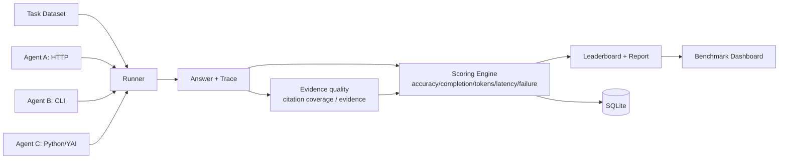
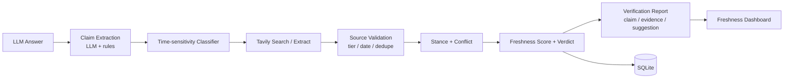

# YAI Scout 共享技术架构（Shared Core）

> 适用范围：Benchmark 与 Freshness 两个入口共享的证据核心
> **v2 升级（2026-11-01）**：Claim/Evidence/Snapshot 模型、Adapter 协议、Pareto 与 Replay 的详细规格见 [`differentiation-spec.md`](differentiation-spec.md) 及三份 `spec-*.md`；本文的模块边界与部署方式不变。
> 原则：**共享底座、独立产品、独立交付**。共享层只实现"两个产品都真正需要"的能力；不为形式独立复制组件。

## 1. 仓库组织（monorepo）

```text
yai-scout/
├── packages/
│   └── scout_core/                 # 共享底座（唯一公共实现）
│       ├── contracts/              # Protocol / Pydantic 模型 / 错误类型
│       ├── adapters/               # AgentAdapter: http / cli / python + 注册表
│       ├── dataset/                # Task schema / 加载 / 版本 / 金标
│       ├── sources/                # Tavily / 直抓 / 去重 / 可靠性分级 / 缓存
│       ├── evidence/               # claim 抽取 / 归一化 / 立场 / 新鲜度评分
│       ├── store/                  # SQLite + 迁移 + 仓储
│       ├── trace/                  # 执行轨迹（事件 / token / 延迟 / 成本）
│       ├── eval/                   # 指标原语（准确率 / 引用覆盖率 / 陈旧率）
│       ├── kernel/                 # YAI 适配层（唯一 YAI 依赖面）
│       └── web/                    # 共享静态资源（设计 token、组件 CSS）
├── apps/
│   ├── benchmark/                  # Project A
│   │   ├── api/                    # FastAPI 路由 /benchmark/*
│   │   ├── runner/                 # 评测执行器
│   │   ├── scoring/                # 榜单与报告
│   │   ├── web/                    # Benchmark Dashboard
│   │   └── README.md               # 独立参赛说明（Project A）
│   └── freshness/                  # Project B
│       ├── api/                    # FastAPI 路由 /freshness/*
│       ├── pipeline/               # claim → 核验 → 评分 → 报告
│       ├── web/                    # Freshness Dashboard
│       └── README.md               # 独立参赛说明（Project B）
├── benchmarks/                     # 数据集（benchmark tasks）
├── tests/
│   ├── core/  benchmark/  freshness/  contract/
├── docs/                           # 本目录
├── deploy/                         # Dockerfile / compose / render.yaml
└── scripts/
```

**独立交付规则**：
1. `apps/benchmark` 与 `apps/freshness` 各自有入口、README、依赖说明、Demo 脚本、验收清单。
2. 单个 app 可在**不启动另一个 app** 的情况下运行（`SCOUT_MODE=benchmark|freshness|all`）。
3. 共享层接口一旦冻结（11/02），两个 app 可并行开发；共享层变更需同时通过两套测试。
4. 两个入口保持在同一个 monorepo 中，通过目录和 README 区分；需要独立包时再拆分，不为演示增加薄仓库。

## 2. 共享模块职责

| 模块 | 职责 | 被谁用 | 不做什么 |
|---|---|---|---|
| `contracts` | `AgentAdapter` / `SourceProvider` / `EvidenceExtractor` / `Scorer` 协议；Pydantic 模型；错误类型 | 两个 app | 不依赖 FastAPI / DB |
| `adapters` | 统一 Agent 接入：HTTP（JSON）、CLI（子进程 + stdout JSON）、Python（import path）；超时、重试、错误归一 | Benchmark | 不内置任何具体 Agent |
| `dataset` | Task schema（问题 / as_of / 类别 / 金标 / 证据）、加载器、版本号、去污染检查 | Benchmark（主）、Freshness（示例题） | 不做数据抓取 |
| `sources` | Tavily 客户端（key/keyless）、直抓、canonical URL、去重、T1–T4 分级、缓存、credits 记账 | 两个 app | 不做 claim 判断 |
| `evidence` | claim 抽取（LLM + 规则兜底）、时效类型、数字归一、stance 判定、Freshness Score、证据引用 | Freshness（主）、Benchmark（证据质量指标） | 不做 UI |
| `store` | SQLite schema 与仓储：run / task / answer / claim / evidence / verdict / event / cost | 两个 app | 不做业务规则 |
| `trace` | 事件流（stage/tool/claim/verdict）、token/延迟/成本采集、可回放 | 两个 app | 不做展示 |
| `eval` | 指标原语：accuracy、citation coverage、stale rate、cost、latency；聚合 | 两个 app | 不做排名呈现 |
| `kernel` | YAI 唯一依赖面；`kernel_status()` / `build_agent_core()` | Benchmark 的 YAI 参考 Agent | 不把 YAI 变成硬依赖 |

## 3. 核心契约（冻结目标：2026-11-02）

```python
# adapters
class AgentAdapter(Protocol):
    id: str
    name: str
    async def answer(self, task: Task, *, as_of: str) -> AgentAnswer: ...

class AgentAnswer(BaseModel):
    text: str
    citations: list[str] = []
    tokens: int = 0
    latency_s: float = 0.0
    cost_usd: float = 0.0
    trace: list[TraceEvent] = []
    error: str | None = None

# sources
class SourceProvider(Protocol):
    async def search(self, query: str, *, max_results: int = 5) -> list[SourceRef]: ...

# evidence
class EvidenceExtractor(Protocol):
    async def claims(self, answer: str) -> list[Claim]: ...

class FreshnessScorer(Protocol):
    async def verify(self, claim: Claim, *, as_of: str) -> Verdict: ...
```

**稳定性约定**：两个 app 只依赖 `packages/scout_core/contracts`，不 import 对方 app 的内部模块。

## 4. 数据模型（SQLite，共享）

```text
task(id, version, question, as_of, category, gold_json, source_json, notes)
agent(id, name, kind, config_json)
run(id, app, task_id, agent_id, status, config_hash, started_at, finished_at, error)
answer(run_id, text, citations_json, tokens, latency_ms, cost_usd, error)
trace_event(run_id, seq, type, payload_json, ts)
claim(id, run_id, text, claim_type, numbers_json, time_sensitive)
evidence(claim_id, url, domain, published_at, tier, snippet, stance, relation_score)
verdict(claim_id, status, score, rationale, checked_at)
score(run_id, metric, value)
cost_ledger(run_id, provider, unit, amount, credits, usd)
```

存储策略：SQLite + WAL；快照/导出的原始页面落 `data/snapshots/<hash>`（演示期保留，赛后按需清理）。Postgres 迁移留接口（仓储层已抽象）。

## 5. 数据流

### Benchmark（Project A）



### Freshness（Project B）



## 6. HTTP 接口（统一前缀）

| App | 方法 | 路径 | 说明 |
|---|---|---|---|
| 共享 | GET | `/healthz` `/readyz` `/metrics` | 运维 |
| Benchmark | GET | `/benchmark/tasks` `/benchmark/agents` | 数据集 / 适配器 |
| Benchmark | POST | `/benchmark/runs` | `{agent_ids, task_ids, config}` → run_id（异步） |
| Benchmark | GET | `/benchmark/runs/{id}` | 状态 / 进度 / 结果 |
| Benchmark | GET | `/benchmark/leaderboard?run_id=` | 榜单 |
| Benchmark | GET | `/benchmark/runs/{id}/report` | Markdown/JSON 报告 |
| Freshness | POST | `/freshness/verify` | `{answer, as_of?, max_claims?}` → report（可同步/异步） |
| Freshness | GET | `/freshness/reports/{id}` | 报告 + 证据 |
| Freshness | POST | `/freshness/verify/batch`（Should） | 批量答案 |
| Freshness | GET | `/freshness/reports/{id}/export` | Markdown/JSON |

SSE：Benchmark 用 `/benchmark/runs/{id}/events`，Freshness 用 `/freshness/reports/{id}/events`（可选，最小实现用轮询）。

## 7. 部署

| 形态 | 说明 |
|---|---|
| 本地开发 | 一个进程 `SCOUT_MODE=all`（两个路由都挂载）；或两个进程分别跑两个 app |
| 参赛 Demo | **一个容器**同时提供 `/benchmark` 与 `/freshness` 两个入口（共享 landing page），但两个入口各自可独立访问、独立 README |
| 独立部署（可选） | `SCOUT_MODE=benchmark` / `freshness` 各起一个容器（同一镜像、不同环境变量） |
| 免费层注意 | Render 免费层无持久盘：SQLite 与快照重启即丢；Demo 依赖镜像内 fixtures + 单次运行 |

## 8. 现有代码迁移（从 G0 到双项目）

| 现有 | 迁移到 | 动作 |
|---|---|---|
| `src/yai_scout/retrieval/*` | `packages/scout_core/sources/*` | 移动 + 保持 API |
| `src/yai_scout/store.py` | `packages/scout_core/store/*` | 扩表（claim/verdict/run） |
| `src/yai_scout/detector/*` | `apps/freshness/pipeline/*` + `scout_core/evidence` | 拆分：抽取/评分进 core，流程进 app |
| `src/yai_scout/benchmark/*` | `apps/benchmark/*` + `scout_core/adapters` | 拆 adapters 到 core |
| `src/yai_scout/api/app.py` | `scout_core/web` + 两个 app 的 router | 拆路由 |
| `docs/charter.md` | 保留为总纲，新增两份项目 Charter | — |

迁移原则：**先冻结接口，再搬代码**；每一步保持测试绿；两个 app 在 11/04 前能各自独立启动。
