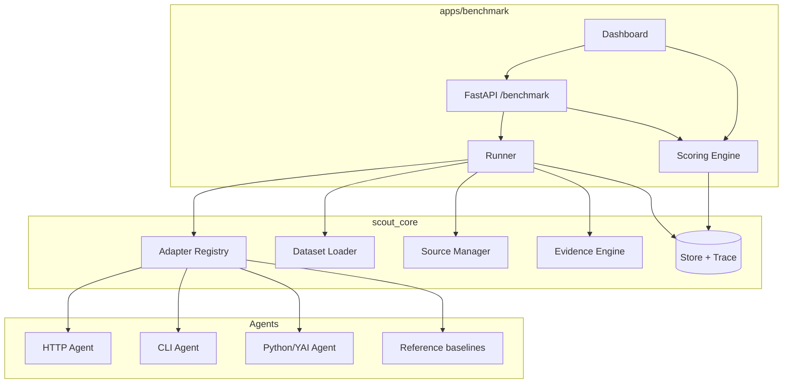

# YAI Scout Benchmark — Project Charter（Bifrost Track / Problem 02）

> 状态：**立项（v1.0）** · 2026-11-01 · 独立参赛作品 A
> **v2 升级（2026-11-01）**：差异化定位为 **Freshness-aware Benchmarking**；指标、Adapter 协议、Dataset、Pareto 与验收以 [`differentiation-spec.md`](differentiation-spec.md) 与 [`spec-benchmark-adapter.md`](spec-benchmark-adapter.md) 为准。
> 赛题：*Build a benchmarking platform for AI agents, not just models.*
> 中文：**构建一个面向 AI Agent 的评测平台，而不只是评测模型。**

## 1. 题目要求与我们的回答

官方要求（转译）：
- 选择一种 Agent 类型（Coding / Support / Research 等）；
- 允许**不同技术架构**的 Agent 接入；
- 让不同 Agent 在**相同任务**上运行；
- 用**统一标准**展示真实表现。

我们的回答：**一个面向 Research Agent 的可复现评测平台**——把"答案对不对、证据硬不硬、信息新不新、成本高不高"放在同一张榜上；Agent 通过统一 Adapter 协议接入，不绑定任何框架或模型。

**差异化一句话**：*Most benchmarks score answers. We score answers **and** the evidence behind them.*

## 2. 产品定位

| 项 | 内容 |
|---|---|
| 用户 | Agent 开发者（想证明自己的 Agent 更强）、研究者（想比较架构）、赛事评委（想看真实差异） |
| 核心价值 | 跨架构、可复现、多指标、可下钻到单条证据 |
| 不做什么 | 不做"又一个模型跑分"；不做只跑 YAI 的自嗨榜；不做 SaaS 多租户 |

## 3. 范围（MoSCoW）

| 级别 | 功能 | 验收 |
|---|---|---|
| **Must** | 统一 Agent Adapter 协议（HTTP / CLI / Python） | 三类各跑通 1 个 Agent |
| **Must** | 15 道标准化 Research 任务 + 金标 | 全部有金标值与来源 |
| **Must** | 自动 Runner（并发、超时、重试、预算） | 一次运行 15 题 × 3 Agent，可中断可重跑 |
| **Must** | 多指标评分（准确率/完成率/证据质量/token/时延/失败率） | 每项指标可解释、可导出 |
| **Must** | 排行榜 + 单题下钻 + 执行轨迹 | 点进任一结果可看答案、引用、轨迹 |
| **Must** | 可复现 | 相同配置 + 相同数据 → 分数一致（±0.02） |
| Should | Bifrost 网关模式（failover/延迟对比） | 可开关，且评测时缓存关闭 |
| Should | 报告导出（Markdown/JSON） | 一键导出 |
| Could | 历史趋势 / 多轮评测对比 | — |
| Won't | 账号体系 / 付费 / 实时监控 | — |

## 4. 架构（Project A 视角）

**职责边界**：Adapter/Runner/Scoring 属于 app；Adapter 协议、数据集、来源、证据指标属于 core（详见 `docs/architecture-shared.md`）。

## 5. Agent Adapter 协议（核心资产）

统一输入：`{question, as_of, task_id}`；统一输出：`{answer, citations[], tokens, latency_s, cost_usd, trace[], error}`。

| 类型 | 接入方式 | 示例 | 约束 |
|---|---|---|---|
| HTTP | `POST {endpoint}` JSON | 任意在线 Agent | 90s 超时，失败重试 1 次 |
| CLI | `subprocess.run([cmd, ...], stdin=task_json)` | 本地脚本/其他语言 Agent | 120s 超时，stdout 必须 JSON |
| Python | `module:callable` import | 同仓库 Agent、YAI 参考 Agent | 进程内隔离，异常隔离 |

**公平性规则**：同一 task 的 as_of、检索预算、超时一致；记录 Agent 的模型/工具配置；禁止针对题目硬编码（数据集留 3 道隐藏题）。

## 6. 数据集设计

15 道题，覆盖 5 类（pricing / version / law / date / statistic），每题含：`question, as_of, category, gold_values[], gold_sources[], notes`。

- 主题限定在 **AI 开发者生态**（Tavily/Bifrost/DeepSeek/Claude/YAI/赛事规则），全部有官方来源、可核验、非政治敏感。
- **防污染**：10 道公开 + 5 道隐藏（提交前不放出）；隐藏题只用于最终报告。
- **金标**：值 + 来源 URL + 抓取日期；数字容差在 loader 里定义。
- 版本：`dataset_version = 1`；任何改动升版本并在报告注明。

## 7. Runner

- 任务 × Agent 并发执行（默认并发 2，可配）；单任务超时 120s；失败重试 1 次（记录首次错误）。
- **隔离**：每个 Agent 调用在独立超时/异常边界内；一个 Agent 崩溃不影响整场。
- **可复现**：`config_hash = hash(agents + tasks + as_of + budget + code_version)`；报告记录 hash。
- **预算**：每次 run 记录 Tavily credits、模型 token、USD；触顶停止并标记。
- **轨迹**：stage、工具调用、检索 query、证据、耗时全部落 `trace_event`。

## 8. 评分模型

| 指标 | 定义 | 权重 |
|---|---|---|
| Answer Accuracy | 金标值命中率（数字容差/字符串匹配） | 0.35 |
| Evidence Quality | 引用覆盖率 × 来源可靠性（T1–T4 加权）× 引文可回溯 | 0.20 |
| Completion | 是否给出非空、非拒答答案 | 0.15 |
| Token Efficiency | 与同题最优 Agent 的 token 比值（归一化） | 0.10 |
| Latency | p50 时延归一化 | 0.10 |
| Failure Rate | 失败/超时比例（扣分项） | 0.10 |

**说明**：权重是产品选择，不是官方口径；报告必须展示每个分项，避免"黑箱总分"。不把合成 Agent 的分数当真实排名（UI 标注 synthetic）。

## 9. Dashboard / 报告

- Leaderboard：排名、总分、分项、成本、时延、失败率；可切换 run。
- Task Detail：题目、金标、各 Agent 答案、引用、证据、轨迹。
- Compare：任意两个 Agent 逐题对比（赢/平/输）。
- Report：Markdown/JSON 导出（含 config hash、数据集版本、局限声明）。
- **统一入口**：`/` 落地页 → Benchmark / Freshness 两个模式（见 `docs/dual-project-plan.md`）。

## 10. API（Project A）

| 方法 | 路径 | 说明 |
|---|---|---|
| GET | `/benchmark/tasks` `/benchmark/agents` | 数据集 / 适配器 |
| POST | `/benchmark/runs` | 创建评测（异步） |
| GET | `/benchmark/runs/{id}` | 状态 + 结果 |
| GET | `/benchmark/runs/{id}/events` | SSE 进度（可选） |
| GET | `/benchmark/leaderboard?run_id=` | 榜单 |
| GET | `/benchmark/runs/{id}/report` | 导出 |

## 11. 存储 / 技术栈 / 部署

- 存储：SQLite（run/answer/trace/score/cost）+ 文件（报告导出）；Postgres 迁移留接口。
- 技术栈：Python 3.12、FastAPI、Pydantic v2、httpx、SQLite、原生 JS（或 React 可选）；YAI 仅用于一个参考 Agent。
- 部署：单容器（`SCOUT_MODE=benchmark`）或与 Freshness 同镜像双路由；Render 免费层（无持久盘，Demo 用 fixtures）。

## 12. MVP 验收标准（必须逐条可勾）

- [ ] 3 类 Adapter（HTTP/CLI/Python）各接入 ≥1 个 Agent；其中 ≥1 个**非 YAI**、≥1 个外部进程。
- [ ] 15 题数据集（10 公开 + 5 隐藏），全部有金标与来源。
- [ ] 一次 run 完成 15 题 × 3 Agent，失败不中断，结果落库。
- [ ] 6 项指标全部计算并在 Dashboard 展示；报告可导出。
- [ ] 相同 `config_hash` 重跑，分数差异 ≤0.02（mock 与确定性 Agent）。
- [ ] 每个结果可下钻到答案、引用、轨迹；合成 Agent 明确标注 synthetic。
- [ ] `pytest` 覆盖 runner/scoring/adapter；CI 绿。

## 13. Demo 脚本（2 分钟）

1. 0:00–0:20 问题：同一道研究题，三个 Agent 答案不同，谁更可信？
2. 0:20–0:50 三个 Agent 接入演示（HTTP 在线 / CLI 本地 / Python 内置），一键跑同一批任务。
3. 0:50–1:30 榜单：准确率、证据质量、token、时延、失败率；点开一个结果看轨迹。
4. 1:30–1:50 可复现：展示 config hash + 重跑一致。
5. 1:50–2:00 Bifrost 网关模式（可选）：failover 与延迟对比。

## 14. 风险

| 风险 | 缓解 |
|---|---|
| 工作量挤占 Freshness | 共享底座先行；Benchmark 以"能跑 3 类 Agent + 15 题"为底线 |
| 评委认为"又一个排行榜" | 用证据质量/可复现/跨架构三点讲差异；现场接外部 Agent |
| 外部 Agent 接入不稳定 | 演示用 1 个在线 + 1 个本地 CLI + 1 个内置；在线失败有录屏 |
| 数据集被质疑"太简单/太少" | 5 道隐藏题 + 公开可复现；报告声明局限 |
| Bifrost 未强制使用 | 定位为可选增强，不作为核心卖点 |

## 15. 与 YAI 的关系

- 平台**不依赖 YAI**；YAI 只作为一个参考 Agent（`kernel/yai_adapter.py`）。
- 复用清单与许可证见 `docs/yai-reuse.md`（v0.25.0 / tag `614f3106...` / MIT）。
- 赛事叙事：YAI 是"被测对象之一"，不是"评测平台的地基"——这正是 Bifrost-02 要的跨架构公平性。
