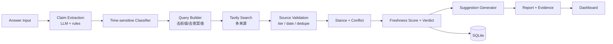

# YAI Scout Freshness — Project Charter（Tavily Track / Problem 01）

> 状态：**立项（v1.0）** · 2026-11-01 · 独立参赛作品 B
> **v2 升级（2026-11-01）**：新增 Temporal Sensitivity 分类、target_time、完整状态机与 Evidence Inspector；评分与边界以 [`spec-freshness-scoring.md`](spec-freshness-scoring.md) 为准。
> 赛题：*Stale-answer detector.*
> 中文：**过时答案检测器**——检测 LLM 答案中已过时/可能过时的事实，并用实时检索重新验证。

## 1. 题目要求与我们的回答

官方要求（转译）：
1. 接收任意 LLM 生成的答案；
2. 识别可能已过时的事实声明；
3. 对每条可疑声明做实时检索；
4. 用最新来源重新验证；
5. 为每条声明生成 **Freshness Score**；
6. 标记过时、不准确或缺乏最新证据的内容。

典型过时信息：定价、API 版本、法律、领导层变动。

我们的回答：**Claim 级、可解释、逐条证据溯源**的检测器。不是"搜一下再让模型重写答案"，而是：拆 claim → 判时效类型 → 实时检索 → 来源校验 → 立场判定 → Freshness Score → 修正建议。

**差异化一句话**：*We don't just say "this may be outdated" — we show which claim, which source, and why.*

## 2. 产品定位

| 项 | 内容 |
|---|---|
| 输入 | 任意 LLM 答案（粘贴文本 / `POST` API / 批量） |
| 输出 | 逐条 claim 的判定（fresh / stale / uncertain / unverifiable）+ 分数 + 证据 + 修正建议 |
| 用户 | 内容审核、研究助理、Agent 开发者、普通用户（"这句话还可信吗？"） |
| 不做什么 | 不做通用事实核查百科；不做整段重写；不做付费墙抓取 |

## 3. 范围（MoSCoW）

| 级别 | 功能 | 验收 |
|---|---|---|
| **Must** | 答案输入（文本 + API） | 粘贴/提交均可，返回报告 id |
| **Must** | Claim 抽取（LLM 为主 + 规则兜底） | 混合语言答案可抽 ≥5 条；无模型 key 时规则可用 |
| **Must** | 时效类型识别 | pricing / version / law / leadership / date / statistic 至少 4 类 |
| **Must** | Tavily 实时验证（多来源） | 每条 claim ≥1 次检索，取前 4 条来源 |
| **Must** | Freshness Score + 状态 | 0–100 + 4 状态 + 理由 |
| **Must** | 逐条证据引用 | URL / 标题 / 域名 / 发布时间 / 来源档位 / 片段 |
| **Must** | 验证报告（含修正建议） | 每条 claim 给出"最新值/建议表述" |
| **Must** | 与 Benchmark 共享底座 | 复用 sources/evidence/store/trace |
| Should | As-of 时间旅行 | 同一答案在 2025-06 / 2026-11 两个 as_of 下对比 |
| Should | 批量检测 + 导出 Markdown/JSON | — |
| Could | 来源快照存档（可回查原文） | — |
| Won't | 自动修改原答案并发布 / 多租户 | — |

## 4. 架构（Project B 视角）



职责：`evidence`（抽取/评分）在 `scout_core`；流程编排与 UI 在 `apps/freshness`。

## 5. Claim 抽取

- **LLM 抽取（主）**：结构化输出 `{claims:[{text, type, numbers, time_scope}]}`，只允许抽取给定答案中的事实句；失败重试 1 次，再失败用规则。
- **规则兜底**：句切分（不切开 `0.25.0`）→ 信号词（价格/版本/法规/人事/日期/统计）→ 数字归一。
- **时效类型**：pricing、version、law、leadership、date、statistic、other；只有"时间敏感"类型进入验证（稳定常识可跳过并标注）。
- **去重**：同一事实的不同表述按数字+主题合并（规则版先做精确去重，LLM 版做语义合并）。

## 6. 验证与判定

对每条 claim：
1. 构造查询：去掉"旧资料显示/根据…"前缀与答案值，保留主题词（≤380 字符）。
2. Tavily search（basic，max 4）；必要时 extract 取正文（Should）。
3. 来源校验：域名档位（T1 一手/T2 权威/T3 一般/T4 UGC）、发布时间、canonical 去重。
4. 立场判定：数字型 claim 比较值（命中=supports；同单位不同值=contradicts）；非数字型先标 mentions（LLM 版再判）。
5. 冲突检测：同一 claim 下 supports 与 contradicts 并存 → 标记"来源冲突"。

## 7. Freshness Score（确定性、可解释）

```text
基础 50
+ 30 近 120 天支持证据        + 15 历史支持
- 40 近 120 天矛盾证据        - 25 历史矛盾
+ 10 一手来源 / +5 权威二手
- 20 无一年内任何证据
clamp 0–100
```

状态：
- `fresh`：有支持且 ≥65；
- `stale`：有矛盾且 <55；
- `unverifiable`：没有可核验来源；
- `uncertain`：其余（证据不足/冲突/过旧）。

> 明确声明：**这是证据强度分，不是概率**。报告展示计算公式与每条证据的贡献。

## 8. 报告与修正建议

每条 claim 一段：

| 字段 | 内容 |
|---|---|
| 原始声明 | 答案中的原句 |
| 类型 / 时间敏感 | pricing / version / … |
| 判定 / 分数 | stale 32/100 |
| 证据 | 2–5 条：URL、标题、域名、发布时间、档位、摘要、立场 |
| 冲突 | 若来源互相矛盾，并列展示 |
| 修正建议 | "官方现值为 1,000 credits/月（docs.tavily.com，2026-10-28）" |
| 更新时间 | 核验时间 |

整体报告：答案级 Freshness Score（claim 均值）、stale 数、耗时、credits、as_of。

## 9. API / 存储 / 技术栈 / 部署

| 方法 | 路径 | 说明 |
|---|---|---|
| POST | `/freshness/verify` | `{answer, as_of?, max_claims?}` → 报告（同步或异步） |
| GET | `/freshness/reports/{id}` | 报告 + 证据 |
| GET | `/freshness/reports/{id}/export` | Markdown/JSON |
| GET | `/freshness/reports/{id}/events` | SSE（可选） |

- 存储：`detector_report` / `claim` / `evidence` / `verdict`（SQLite）；证据快照可选。
- 技术栈：Python 3.12 + FastAPI + Tavily REST（httpx）+ DeepSeek（claim 抽取/关系判定，key 待补）+ 原生 JS。
- 部署：单容器（`SCOUT_MODE=freshness`）或与 Benchmark 同镜像双路由；Render 免费层。

## 10. MVP 验收标准

- [ ] 5 组对抗性答案（含旧价格、旧版本、旧法规、旧 CEO、正确对照）全部可检测。
- [ ] 每条答案抽取 ≥80% 人工标注的 claim（20 条标注集）。
- [ ] 每条 verdict 至少 1 条证据，或明确标注 `unverifiable`；证据必须带 URL 与时间。
- [ ] stale 判定在 20 条标注 claim 上 precision ≥0.8、recall ≥0.7（规则版基线；LLM 版目标 ≥0.85）。
- [ ] 6 条 claim 的报告 ≤60s（keyless 可放宽到 90s），credits ≤12。
- [ ] 报告含修正建议；可导出 Markdown。
- [ ] 无模型 key 时规则版仍可完整跑通（降级不崩）。

## 11. Demo 脚本（2 分钟）

1. 0:00–0:20 一段"看起来很正常"的 AI 答案（含旧价格/旧版本）。
2. 0:20–0:50 点击检测 → claim 列表逐条出现，stale 标红，分数与证据展开。
3. 0:50–1:20 点开一条 claim：原文、官方现值、来源时间、为什么判定过时、修正建议。
4. 1:20–1:40 换一条"正确"的事实：判 fresh，并说明来源为什么可信（一手来源）。
5. 1:40–2:00（Should）As-of 时间旅行：同一答案在 2025-06 判 fresh、2026-11 判 stale——"时间让它过时"。

## 12. 风险

| 风险 | 缓解 |
|---|---|
| claim 抽取漏/错 | LLM + 规则双通道；标注集评估；报告显示"未识别"数量 |
| 检索结果与 claim 不相关 | 查询清洗；域名/时间过滤；无关结果标 mentions 不计分 |
| 误判 stale（假阳性） | 只在"同单位不同值"或权威来源冲突时判 stale；阈值可调 |
| Tavily 限流/额度 | 预算上限、缓存、keyless 兜底、每答案 claim 上限 |
| 与 Benchmark 抢时间 | 共享 evidence 层；Freshness 优先（Tavily 轨核心） |

## 13. 与 YAI 的关系

- Freshness 产品**不依赖 YAI**（检索 + 抽取 + 评分均由 Scout 实现）。
- 可选：用 YAI `AgentCore` 做"多步核验 worker"（P2），或作为 Benchmark 里的一个被测 Agent。
- 复用/许可证见 `docs/yai-reuse.md`。
