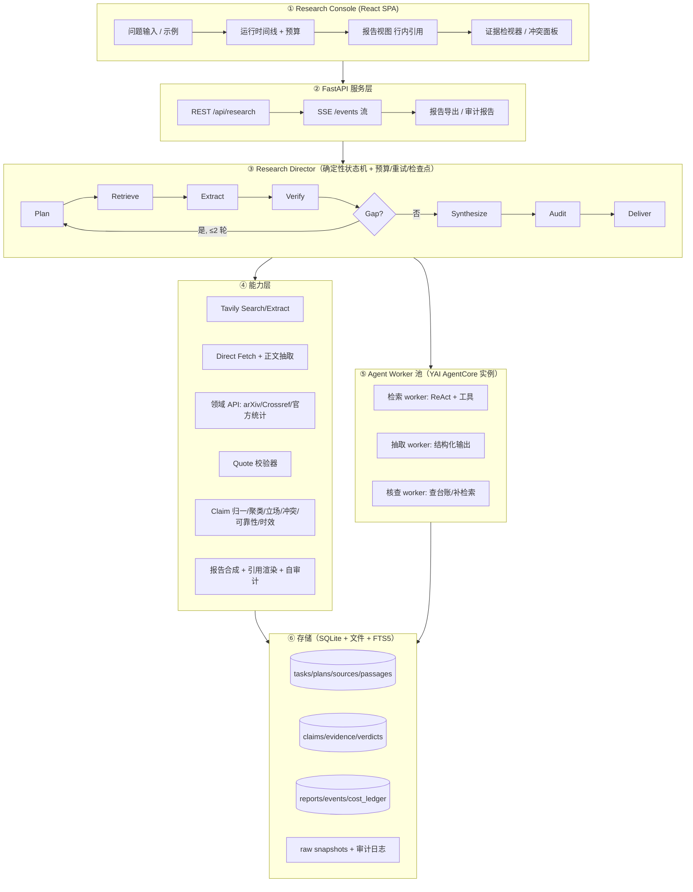

# YAI Scout — Project Charter

> **注意（2026-11-01 更新）**：本文件是早期"整合项目"方案的总纲，仍保留作背景资料。
> 现行决策已改为 **双作品 + 共享底座**，见 `docs/adr/0002-dual-project-strategy.md`、
> `docs/charter-benchmark.md`、`docs/charter-freshness.md`、`docs/architecture-shared.md`。

> **Evidence First, Answers Second.**
> 版本 v0.1（预研版） · 编制日期 2026-10-31 · 状态：待确认 · 编制人：YAI Scout 项目组（个人参赛）

---

## 0. 执行摘要

**YAI Scout 是一个 Evidence-based Research Agent**：把复杂的开放域研究问题拆成检索计划，从多个独立来源收集材料，抽取带原文引文的证据，做跨来源交叉验证，显式标记冲突与证据不足，最后产出一份**每句话都能回溯到原文**的研究报告。

本文件是参赛前的完整立项与技术预研（Project Charter），覆盖：赛事事实核查、赛道适配策略、技术架构、YAI 复用边界、MVP 范围、评测体系、成本与工期、仓库结构、11/15 倒排计划与风险登记册。

### 0.1 结论先行（Key Findings）

| # | 结论 | 影响 |
|---|---|---|
| F1 | **个人参赛合规**：官方允许 1–4 人团队，个人可直接作为 1 人队提交；一人只能在一支队伍 | 无需凑队，决策链最短 |
| F2 | **真实截止是北京时间 2026-11-16 02:29**（= 11/15 23:59 IST），题目公布是 **11/1 02:30**（= 11/1 00:00 IST） | 可开发窗口 14 天 23 小时 59 分（跨 15 个日历日）；必须按 IST 换算排期，不能按北京时间 11/15 24:00 理解 |
| F3 | **题目与赛道截至编制时仍未公布**（官方写 "REVEALING SOON"） | 必须采用「轨道无关内核 + 48 小时适配」策略，不能押题 |
| F4 | 官方**没有强制使用** Tavily / Bifrost 等合作方 API；Tavily（by Nebius）是 Track Partner，Bifrost（Maxim AI）是 Title/Track Partner | 用 Tavily 是"加分项 + 数据源"，不是合规门槛；必须真用出价值而非贴 logo |
| F5 | Tavily 免费额度 **1,000 credits/月**（basic search 1 credit、advanced 2 credits、extract 每 5 个 URL 1–2 credits） | 单份报告预算可压到 **23–32 credits**（取决于是否触发补检索），免费额度约支撑 **30–43 份**完整报告/月 |
| F6 | 奖金结构需下调预期：**现金仅 $1,000**；$11.5K 是含厂商 credits 的"总奖池"口径，但官方未解释构成——100×$65 + 100×$50 = $11,500 恰好等于该数，若再加 $1,000 现金则为 $12,500，**口径不自洽** | 参赛动机应是作品与曝光；提交材料中不引用具体奖金构成数字 |
| F7 | 规则要求**核心项目在赛期内开发**（既有库/框架可复用） | 本次预研只产出设计与验证性资料；核心代码 11/1 题目公布后再写（同时满足"不修改 YAI 主仓库、不提前大规模编码"的约束） |
| F8 | 评审为 6 个定性维度且**权重未公开**：Innovation / Technical execution / Problem & impact / Use of AI / UX / Scalability | 交付物必须让"技术深度"和"AI 使用方式"在 2 分钟视频里可见，不能只靠代码 |
| F9 | 复用 YAI Agent Core **v0.25.0**（tag commit `614f3106c7237b8bee662b925748b56c4da6d890`，MIT）作为嵌入式 Agent 内核 | 省掉 Agent Loop / 工具调用 / MCP / 模型适配 / 授权治理，把 14 天花在证据层与验证层 |
| F10 | MVP 的胜负手不是"能搜"，而是**引文保真 + 冲突显式化 + 引用自审计** | 全部评测指标围绕这三点设计 |

### 0.2 一页纸范围

- **做**：面向复杂问题的研究流水线（Plan → Retrieve → Extract → Verify → Re-plan → Report → Audit）、证据台账、冲突/不足标记、带行内引用的结构化报告、可回放的运行轨迹、可离线演示的 Demo。
- **不做**（本期）：通用聊天/写作、多租户与账号体系、团队协作、语音/多模态输入、付费墙抓取、爬虫农场、Omnidimension 语音集成（除非赛道题目要求）。
- **资源**：1 人 + AI 编码代理；现金支出目标 **≤ $20**（Tavily 免费额度 + 付费充值 ≤$13 + 模型 ≤$10）；部署用 Render 免费层（文件系统临时，见 §8.2）或本地 Docker；不创建任何收费资源。

### 0.3 需要项目发起人确认的 7 件事

1. 每日可投入工时（决定 Must/Should 边界，见 §8.1 容量模型）。
2. 是否授权**本人**完成赛事注册（HackCulture 账号 + Discord 强制加入，邀请链接可能 11/8 失效）。
3. 总现金预算（建议 **$20**：模型 ≤$10 + Tavily 备用充值 ≤$13，实付按量；单份报告成本 $0.06–0.25）。
4. 演示与提交材料语言（建议 UI/README/视频以英文为主，中文为辅；评审为国际评委）。
5. 交付形态（本 Charter 是否需要同步产出 DOCX/PDF 版）。
6. 是否具备学生身份以申请 Tavily 学生计划（4,000 credits/月 × 4 个月，官方写明可用于 hackathon）。
7. 年龄资格：平台条款为 18+，13–18 需监护人/学校同意；若适用请先确认（未满 18 会阻塞报名）。

---

## 1. 赛事事实核查（截至 2026-10-31 22:59，UTC+8）

> 核查方法：官方赛事页两次独立抓取比对 + HackCulture 平台条款 + Geek Room 官网原始 HTML + 搜索引擎二手信息交叉验证。**官方原文优先**；未公开项如实标注，不做推测性填空。

### 1.1 已确认事实

| 项目 | 事实 | 来源 | 置信度 |
|---|---|---|---|
| 赛事名称 | Geek Room — Global AI Hackathon（"Build Globally. Ship Boldly."） | Geek Room 赛事页 / HackCulture | 官方 |
| 主承办 | Geek Room 主办，HackCulture 平台承办（报名与提交入口在 HackCulture） | HackCulture | 官方 |
| 时间 | 2026-10-09 → 2026-11-29，全程线上、全球开放 | 两站一致 | 官方 |
| 团队 | 1–4 人；个人可直接参赛；一人只能加入一支队伍；每队仅 1 件作品 | HackCulture Eligibility / Rule 4 / Rule 8 | 官方 |
| 资格 | 任何国家、任何背景与技能水平；无学历/经验要求；学生/开发者/研究者均可 | Eligibility | 官方 |
| 年龄 | 赛事页未写；平台条款为 18+，13–18 需监护人/学校同意，<13 禁止（**若接近 18 岁，报名前自行向主办方确认**） | HackCulture 条款 | 官方（平台级） |
| 报名截止 | 2026-11-15 23:59 **IST**（= 北京时间 11-16 02:29） | Schedule | 官方 |
| 题目公布 | 2026-11-01 00:00 **IST**（= 北京时间 11-01 02:30）；同时开启提交窗口 | Schedule / FAQ | 官方 |
| 原型提交截止 | 2026-11-15 23:59 **IST**（同上换算） | Schedule | 官方 |
| 评审 | 2026-11-29 19:00–23:59 **IST**（约 5 小时窗口，线上） | Schedule | 官方 |
| 时区基准 | 页面头部明确 "8:00 AM – 11:59 PM · IST" | HackCulture | 官方 |
| 赛道 | **未公布**，页面写 "Problem statements and theme tracks are currently being finalized" | Themes 区 | 官方 |
| 合作方角色 | Bifrost (Maxim AI) = Title/Track Partner；Tavily (Nebius) = Track Partner；Omnidimension、Pathway = Community Partner | Partners 区 | 官方 |
| 合作方 API | **未强制使用**；Bifrost 仓库仅作为 "technical resource" 推荐 | Rule 7 / Build Resources | 官方 |
| 沟通 | **必须加入官方 Discord**；违规可被取消资格 | Rule 3 | 官方 |
| 提交物 | ①可运行项目或 Demo ②源码/仓库 ③项目描述 ④所解决问题说明 ⑤技术栈 ⑥**AI 使用方式说明** ⑦Demo 视频（"if required"，建议默认准备） | Rule 7 | 官方 |
| 评审维度 | Innovation / Technical execution / Problem and potential impact / Use of AI / User experience / Scalability and potential（**无权重、无评分细则**） | Rule 10 | 官方 |
| 原创性 | 必须原创或有权使用；**核心须在赛期内开发**；既有库/框架/boilerplate 可用 | Rule 1 / Rule 5 | 官方 |
| 知识产权 | 参赛者保留所有权；平台获非独占免费许可用于展示与运营 | 平台条款 | 官方 |
| 奖项 | 总奖池 $11.5K；现金 $1,000；Tavily credits $65 / 100 名；Omnidimension voice credits $50 / 100 名；完赛证书 | Prizes 区 | 官方 |
| 奖池口径 | 官方写"$11.5K prize pool, including $1,000 cash"，但 credits 部分 100×$65 + 100×$50 = $11,500 已等于该数；再加 $1,000 现金则为 $12,500 → **官方口径不自洽，无法确认 $11.5K 的构成** | 官方原文 + 算术 | 推断（口径存疑） |

### 1.2 未公开 / 待确认清单（11/1 后以 Discord 公告为准）

| # | 未公开项 | 为何重要 | 获取方式 |
|---|---|---|---|
| U1 | 正式题目与赛道划分（是否分 Tavily/Bifrost 独立赛道） | 决定产品定位与演示脚本 | 11/1 02:30 官方页 + Discord |
| U2 | 评审权重、评分表、评委名单 | 决定投入配比（技术 vs 视觉） | Discord / 评审前公告 |
| U3 | 提交平台与表单字段（HackCulture dashboard?） | 决定材料清单与提前量 | 注册后 dashboard |
| U4 | API credits 的领取方式与条件（"100 winners" vs "all participants" 自相矛盾） | 决定是否要买 Tavily 付费档 | Discord 提问 |
| U5 | Demo 视频是否必需、时长与格式 | 决定录制排期 | 公告 / 提交表单 |
| U6 | 决赛/答辩形式（评审 5 小时窗口内如何展示） | 决定演示脚本与容错设计 | 公告 |
| U7 | 是否允许赛前已有的开源脚手架直接 fork | 影响 YAI 复用叙述方式 | 规则解释 + Discord 确认 |

> 二手信息冲突记录：早期宣传写 "$5,000 prize pool"、"$100 Tavily credits"，官方现行页为 "$11.5K"、"$65 credits"。**以官方现行页为准**，并在提交材料中避免引用具体奖金数字。

### 1.3 对项目的硬约束（由规则推导）

1. **14 天窗口**：11/1 02:30 → 11/16 02:29（北京时间）。倒排计划以"小时"为单位，不以"天"为单位。
2. **合规边界**：核心代码赛期内写。预研阶段（现在）只做：事实核查、架构设计、可行性 spike（可丢弃、≤ 数小时）、评测集选题。**不建核心仓库、不写产品代码、不改 YAI 主仓库、不创建收费资源、不做远程提交。**
3. **提交物导向**：评审看到的是 仓库 + 视频 + 在线 Demo（推测）。因此从 Day 1 起就要维护 README、架构图、演示数据，而不是最后一天补。
4. **AI 使用说明**是独立评分维度：必须讲清"AI 在系统中的哪一个环节、以什么约束工作、如何防止幻觉"，而不是"我们调用了大模型"。
5. **Discord 强制**且邀请链接有时效（实测有效期至 2026-11-08）：越早加入越好，避免错过题目答疑与 credits 领取。

---

### 1.4 合规、许可与数据策略（提交前逐项核对）

| 来源/组件 | 条款与许可 | 限流/约束 | 快照与留存策略 |
|---|---|---|---|
| Tavily API | Tavily Platform Terms；隐私政策（query 可能用于改进服务、可能共享给第三方索引商） | Dev 100 RPM / Prod 1,000 RPM；超限 429 | 只存检索结果摘要与 URL 用于审计；不转售、不再分发；报告注明"Search by Tavily" |
| 直接抓取网页 | 目标站 ToS + robots.txt | 单域名 ≤1 req/s；UA 声明；不绕付费墙/登录 | 仅存正文片段 + URL + 抓取时间；评审后可按需删除；不存 PII |
| arXiv / Crossref / PubMed | 各自 API 条款与内容许可（论文许可逐篇不同） | arXiv 礼貌间隔；Crossref/PubMed 免费但需限速 | 只存标题/摘要/引文片段，不整篇转载；引用标注来源与许可 |
| 维基百科 | CC BY-SA 4.0 | 遵守 API 限流 | 引用需署名与链接；不批量镜像 |
| 开源依赖 | 仅 MIT / Apache-2.0 / BSD；**排除 BSL（Pathway）与 GPL** | — | `NOTICE` 列全部依赖与许可；YAI MIT 声明保留 |
| 用户输入/报告 | 不采集与任务无关的个人信息 | — | 删除入口（按 run id）；日志脱敏（邮箱/电话正则） |

**红线**：不做人身/医疗/法律建议类结论；不生成针对个人的负面断言；不抓取付费墙与隐私数据；不伪造来源。所有页面抓取遵守 robots 与站点条款，报告与 README 均提供来源清单与免责声明。

---

## 2. 问题定义与产品定位

### 2.1 要解决的问题

当一个人需要就一个**复杂、开放、有争议**的问题做判断时（例："某国 2026 年 AI 监管草案对开源模型的实际影响"），今天的主流做法有三种，各自失效方式不同：

| 做法 | 失效模式 |
|---|---|
| 搜索引擎 + 人肉阅读 | 覆盖不全、时间成本高、冲突信息靠人脑记 |
| 聊天机器人直接回答 | 看似流畅，但**无法核验**：来源缺失、张冠李戴、把旧闻当新闻、把单一来源当共识 |
| 通用 Deep Research 产品 | 报告可读，但**证据链不透明**：引用常与论点弱相关，冲突被"平均"掉，读者无法判断哪句可信 |

核心洞察：**研究工作的瓶颈不是"生成文字"，而是"判断哪条证据可信、以及证据之间是否打架"。** 因此产品的核心资产不是报告文本，而是**结构化的证据台账（Evidence Ledger）**——报告只是台账的一个视图。

### 2.2 产品定位

**YAI Scout = 可审计的证据优先研究代理（Evidence-first, Auditable Research Agent）。**

三条不可妥协的设计承诺（也是与竞品的差异点）：

1. **Quote-Verified**：每条证据必须携带**原文逐字引文 + 字符偏移**，系统在入库时回查原文；引文对不上就丢弃。杜绝"LLM 转述式引用"。
2. **Verdict-First**：每个关键事实在写进报告前必须给出**判定**（支持 / 单源 / 冲突 / 证据不足 / 过时），并展示独立来源数与来源可靠性。
3. **Self-Audited**：报告交付前跑一遍自动审计——引用覆盖率、无支撑断言率、引文保真度、数字一致性，指标随报告一起展示。

一句话价值主张（提交材料用）：
> *Most AI research tools give you an answer. YAI Scout gives you the evidence — and tells you where the evidence disagrees.*

### 2.3 目标用户与 Demo 场景

| Persona | 场景 | Demo 价值 |
|---|---|---|
| 研究者/学生 | 写文献综述前快速建立事实基线 | 证据台账可导出、可复查 |
| 分析师/记者 | 核实一个有争议的数字或事件时间线 | 冲突标记 + 来源可靠性分级 |
| 决策者 | 比较多个方案的公开证据强度 | 不确定性显式化，便于"知道哪里不知道" |

Demo 选题原则：**有官方权威源 + 有二手报道分歧 + 有明确时间线 + 不涉及人身/政治敏感**。首选"科技/产业/科研"类问题（例如某开源模型/芯片/航天项目的公开参数与时间线），既好验证又安全。

### 2.4 明确不做（Non-goals）

- 不做通用聊天助手、不写代码、不做文档生成工具。
- 不做"全自动新闻监控/舆情"（合规与伦理风险高）。
- 不抓取付费墙内容、不绕过 robots/ToS、不存储个人隐私数据。
- 不追求"覆盖整个互联网"，只追求**在给定预算内把关键事实的证据强度说清楚**。

---

### 2.5 与现有方案的差异（定位声明）

| 替代方案 | 它强在哪 | 它的缺口 | YAI Scout 的取舍 |
|---|---|---|---|
| 通用 Deep Research 产品 | 速度、覆盖面、交互体验成熟 | 证据链不透明、冲突被"平均"、结论不可复核 | 不追求更快，追求**可检查**：每条结论能点回原文并看到判定 |
| 学术搜索（Elicit / Consensus / Semantic Scholar 类） | 论文内证据质量高、结构化 | 不覆盖新闻/官方文件/产业数据，时效弱 | 多源覆盖，同时把论文与官方源列为 T1 |
| 自建 RAG / 聊天机器人 | 完全可控、成本低 | 无验证层，"有引用"≠"引用支持结论" | 增加 verdict 层与引用自审计，把 RAG 变成台账 |
| 人工研究 | 质量上限最高 | 慢、不可规模化、不可复现 | 定位为"研究加速器 + 可复核台账"，不宣称替代人 |

一句话定位：**不是更快的搜索引擎，而是一份可以检查的研究台账。**

---

## 3. 赛道适配策略（题目未公布）

### 3.1 为什么不能押题

官方明确题目 11/1 才公布，且"multiple tracks, technologies, and challenges"。任何"提前把功能做死"的策略都有 50% 以上概率错配。因此采用：

> **轨道无关内核（Track-Agnostic Core）+ 48 小时适配层（48h Adapter）+ 可弃演示层（Demo Skin）**

- **内核**：证据流水线（检索、抽取、验证、报告）——任何"研究/核实/对比/综述"类题目都用得上。
- **适配层**：题目公布后 48 小时内决定用哪个领域语料、哪些数据源、哪套演示问题、强调哪个合作方能力。
- **演示层**：UI 文案、示例问题、视频脚本可整体替换，不影响内核。

### 3.2 三种情景与应对

| 情景 | 触发条件 | 应对 | 额外成本 | 复用率 |
|---|---|---|---|---|
| **A. Tavily Track（默认最优）** | 存在"用 Tavily 构建搜索/研究/Agent"类题目 | 直接参赛；把 Tavily 用成"多源检索的一等公民"（advanced search + extract + 域名/时间过滤），并在 UI 展示每步消耗的 credits | 0–0.5 人日 | ~100% |
| **B. Bifrost / 可靠性 Track** | 题目强调网关、故障转移、可观测、成本治理 | 增加 Bifrost 自托管网关作为模型入口：多模型 failover + 语义缓存 + 预算/虚拟 key；叙事变成"研究 Agent 的生产级可靠性" | 1–2 人日 | ~90% |
| **C. 主题型题目（气候/金融/医疗/教育…）** | 题目限定领域 | 替换语料域 + 领域数据源（arXiv/PubMed/世界银行/官方统计）+ 3 个领域演示问题；内核不动 | 1–2 人日 | ~85% |
| **D. 完全不匹配** | 题目要求语音/机器人/游戏等 | 放弃赛道匹配，按"开放创新"投；或 48 小时内决定不参赛（沉没成本仅设计文档） | — | — |

### 3.3 题目公布当日（11/1）的 4 小时作战流程

| 时间（北京） | 动作 | 产出 |
|---|---|---|
| 02:30–03:00 | 抓取官方题目页 + Discord 公告，原文存档到 `research/problem-statements/` | 题目原文快照 |
| 03:00–04:00 | 用打分表评估每个 track（见下） | Track 打分矩阵 |
| 04:00–05:00 | 选定 track，写 1 页"适配说明"（题目要求 ↔ 我们的能力映射） | Decision record（ADR-000） |
| 05:00–06:30 | 更新 §6 MVP 清单与 §10 排期，确认 Must 集不变 | 更新后的 Charter v0.2 |

**Track 打分表**（每项 1–5 分，加权）：

| 维度 | 权重 | 判据 |
|---|---|---|
| 题目契合度 | 35% | 我们的证据/验证能力是否直接回答题目 |
| 合作方匹配 | 20% | Tavily/Bifrost 是否天然是解法的一部分 |
| 差异化空间 | 20% | 其他队伍大概率做什么，我们能否不同 |
| 14 天可完成度 | 15% | Must 集是否需要大改 |
| 演示友好度 | 10% | 能否在 2 分钟内展示"证据打架"的高光时刻 |

> 决策规则：只有综合分 ≥ 3.5 的 track 才参赛；若全部 < 3.5，选择"开放创新"并聚焦技术深度。

---

## 4. 技术架构

### 4.1 设计原则

1. **确定性骨架 + 概率性关节**：研究流程（阶段、状态、预算、落库、终止条件）由代码确定性控制；LLM 只负责"拆问题、读段落、判立场、写文字"这些关节。这样系统可暂停、可重放、可评测、失败可定位——而不是"一个 Agent 自己决定一切"。
2. **证据是一等公民，报告只是视图**：所有结论先落 `claim` + `evidence`，报告从台账渲染；任何一句报告文字都必须能点回原文引文。
3. **可回溯到字节**：每条来源保存快照（HTML/PDF 原文 + SHA-256 + 抓取时间）；引文带字符偏移；审计可离线复现。
4. **预算即产品约束**：每个 run 有 credits / 模型调用 / token / 墙钟四个硬上限；触顶时**降级交付**（明确写"证据预算耗尽，以下结论证据不足"），绝不无限检索。
5. **默认离线可演示**：内置 fixtures 与缓存 run，断网也能完整演示；在线模式只是把 fixtures 换成真实 API。
6. **单机零收费可跑**：SQLite + 本地文件即可全功能运行，不依赖向量数据库/队列/云服务。

### 4.2 总体架构



**关键点**：YAI 内核不是"整个系统的控制者"，而是被 Research Director 调度的**执行器**。每个 worker 是一个独立 `AgentCore` 实例（YAI 实例内串行），并发由 Director 的 worker 池控制。这样既拿到 YAI 的工具调用/事件/预算能力，又保住研究流程的确定性与可评测性。

### 4.3 核心数据模型（Evidence Ledger）

| 实体 | 关键字段 | 说明 |
|---|---|---|
| `research_task` | id, question, created_at, status, budget_json, as_of_date | 一次研究请求；`as_of_date` 用于时效判定 |
| `plan` | id, task_id, version, sub_questions[], stop_criteria | 子问题带 `id`/`target_claims`/`required_source_types`；**自建结构**，不用 YAI 的正则 plan |
| `source` | id, url, canonical_url, registrable_domain, title, published_at, fetched_at, content_hash, mime, tier, snapshot_path | `tier` ∈ T1 一手/T2 权威二手/T3 行业/T4 UGC；快照落盘 |
| `passage` | id, source_id, text, char_start, char_end, section, lang | 检索与引用最小单位；FTS5 索引（`passage_fts`） |
| `claim` | id, task_id, sub_question_id, text, normalized_key, claim_type, value, unit, time_scope, polarity | `claim_type` ∈ fact/number/date/relation/causal |
| `claim_evidence` | claim_id, passage_id, stance, quote, quote_start, quote_end, extractor, confidence | `stance` ∈ supports/contradicts/mentions；**quote 必须逐字命中** |
| `verdict` | claim_id, status, independent_sources, tier_mix, agreement, freshness, rationale, grade | `status` ∈ supported/single-source/contested/insufficient/outdated；`grade` A–D |
| `report` | id, task_id, sections[], claim_ids[], markdown, audit_json, rendered_at | 报告正文只引用 `claim_id`，不直接引用 URL |
| `run_event` | seq, task_id, stage, type, payload, ts | SSE 回放与调试；同时供 OTel 导出 |
| `cost_ledger` | task_id, provider, unit, amount, credits, usd_estimate | 每次外部调用记一行，支持预算熔断与成本展示 |

**不变量（Invariants，写进测试）**：
- `claim_evidence.quote` 必须能在对应 `passage.text[*_start:*_end]` 逐字匹配（允许空白归一）；
- 报告中每个 `[C12]` 引用必须存在于 `claim` 表且该 claim 有 ≥1 条 `supports` 证据；
- `verdict.status=supported` 要求 **独立来源数 ≥ 2**（按 registrable domain 去重 + 近重复文本合并后计数）；
- 任一 `source` 必须有 `content_hash` 与 `snapshot_path`，否则不得参与引用。

### 4.4 流水线状态机

| 阶段 | 输入 → 输出 | 退出条件 | 预算上限（默认） |
|---|---|---|---|
| `PLANNING` | 问题 → 3–6 个子问题 + 每子问题 2–4 条查询 + 证据要求 | 计划通过 schema 校验 | 1 次模型调用，≤15s |
| `RETRIEVING` | 查询 → sources（Tavily + 直接抓取 + 领域 API） | 每子问题 ≥3 个独立域名候选 | ≤12 次 search（≈16 credits） |
| `EXTRACTING` | passages → claims + quote 证据 | 首次抽取接受率 ≥80%（未通过者丢弃），入库引文保真 100% | ≤10 次模型调用 |
| `VERIFYING` | claims → verdicts（聚类/立场/冲突/时效） | 全部 claim 有 verdict | ≤6 次模型调用 |
| `GAP_CHECK` | verdicts → 新查询或结束 | 无 insufficient/contested 缺口，或已达 2 轮 | 第 2 轮 ≤8 credits |
| `SYNTHESIZING` | verdicts → 报告章节（带 claim 引用） | 每个子问题都有结论段 | ≤3 次模型调用 |
| `AUDITING` | 报告 → 审计指标 + 修复建议 | 引用覆盖率 ≥95%，无未引用事实句 | ≤1 次模型调用 |
| `DELIVERED / PARTIAL / FAILED` | 报告 + 证据附录 + 运行轨迹 | — | — |

状态机特性：**检查点**（每阶段结束落本地 SQLite；同一实例内可续跑，本地/Docker 部署可跨重启，免费托管层因临时盘不保证跨重启）、**幂等键**（同问题+同预算+同 as_of 命中缓存直接复用）、**取消**（SSE 断开或用户取消 → 只取消未开始的任务，已落库证据保留）。

### 4.5 六个关键机制（差异化所在）

**① Quote-Verified Extraction（引文保真）**
LLM 只允许输出 `{quote, claim, stance}`；抽取器在归一化空白后做**精确子串匹配**，命中才落库并记录 offsets；未命中进入一次"仅允许从给定 passage 中选择"的重试，二次失败即丢弃并计入 `extraction_rejected`。→ 从结构上消灭"编造引文"。

**② 独立来源计数（不是 URL 计数）**
同一篇通稿被 20 家转载不算 20 个来源。做法：registrable domain 去重 + 正文 SimHash 近重复合并 + 引文归属识别（同一句引语反复出现视为同源）。输出的 `independent_sources` 是报告里最值钱的一个数字。

**③ 来源可靠性分级（可解释，不装神）**
T1 一手（政府/监管/标准组织/官方文档/原始数据集/论文原文）、T2 权威二手（通讯社、大报、参考工具书）、T3 行业与专业博客、T4 UGC/聚合/SEO。规则（域名库 + 站点类型）优先，LLM 仅在未知域名时兜底，且**分级理由入库**，用户可查看。

**④ 冲突显式化（绝不"平均"）**
同一 `normalized_key` 下出现数值差 > 容差、日期不一致、极性相反（"批准/否决"）时标记 `contested`；报告用并列卡片呈现双方证据与来源，并给出"无法判定/需一手来源"的结论，而不是选一个看起来更权威的。

**⑤ 证据等级（不编造概率）**
`grade` 由确定性公式给出：`独立来源数 × 来源档位 × 时效 × 一致性` → A/B/C/D 四档，UI 展示计算依据。明确声明"这不是概率"，避免伪精确。

**⑥ 引用自审计（交付前自动跑）**
- 引用覆盖率 = 有 claim 引用的陈述句 / 全部事实性陈述句（目标 ≥95%）
- 无支撑断言率 = 无 supports 证据的 claim 引用数 / 全部引用数（目标 0）
- 引文保真度 = 逐字命中 quote 数 / 全部 quote（结构性 100%）
- 数字一致性 = 报告中的数字能在其引用 quote 中找到（目标 100%）
- 独立来源密度 = 独立来源数 / 引用总数（衡量是否过度依赖单一来源）

审计结果随报告一起展示（"本报告 37 条结论，32 条有 ≥2 个独立来源支持，3 条存在冲突，2 条证据不足"）——这本身就是最好的演示素材。

### 4.6 合作方能力映射

| 合作方 | 在本项目中的角色 | 采用决策 |
|---|---|---|
| **Tavily**（Track Partner） | 主力检索源：basic/advanced search + extract；域名/时间过滤；published_date | **必用**（P0）。封装为 `TavilyAdapter`，逐次记账 credits，支持降级到直接抓取 |
| **Bifrost**（Title/Track Partner） | 可选模型网关：多模型 failover、语义缓存、预算/虚拟 key | **P1 可选**（4–6h）：仅在 Track B 或需要"生产级可靠性"叙事时接入；不引入则不影响 MVP |
| **Omnidimension**（Community） | 语音 Agent | **不用**（与产品无关）；除非赛道强制 |
| **Pathway**（Community） | 流式 RAG/实时数据框架 | **不用**；证据流水线是批式研究，不需要实时流（可在 README 说明取舍理由） |

**额度与领取路径（截至 2026-10-31）**：

| 合作方 | 免费/开源额度 | 领取路径 | 赛事专属额度 | 用途 |
|---|---|---|---|---|
| Tavily | 1,000 credits/月，无需信用卡，每月 1 日重置；Dev key 100 RPM | app.tavily.com 注册 → dashboard 取 `tvly-...` key | 官方页写 "$65 credits / 100 winners"，但另一处写 "for all participants"，**领取方式未公开** → Discord 询问 | 主力检索（P0） |
| Bifrost | Apache-2.0 自托管免费（`npx @maximhq/bifrost` 或 docker）；企业版收费 | github.com/maximhq/bifrost / docs.getbifrost.ai | 未公开 | 可选模型网关（P1） |
| Omnidimension | 免费 20 分钟；Starter $20/月 | omnidim.io | $50 voice credits ×100，领取方式未公开 | 不用 |
| Pathway | Community 免费至 8GB RAM / 4 核；BSL 1.1（非 OSI） | pathway.com/pricing，需 license key | 未公开 | 不用（许可与场景均不匹配） |
| 备用检索 | Brave $5 credits/月、Exa $10/月、Firecrawl 1,000 credits/月、Jina Reader 100 RPM、Semantic Scholar/arXiv/PubMed 免费 | 各自官网注册 | — | 降级方案（P2） |

> **学生身份可额外申请 Tavily 学生计划**：Project 档（4,000 credits/月）免费 4 个月，官方明确可用于 hackathon。这是把检索成本降到 $0 的最优路径（需邮箱/学生证验证）。

### 4.7 API 与事件协议

| 端点 | 方法 | 用途 |
|---|---|---|
| `/api/research` | POST | 创建研究任务（question, budget, as_of），返回 task_id |
| `/api/research/{id}` | GET | 任务状态 + 计划 + 统计 |
| `/api/research/{id}/events` | GET (SSE) | 实时事件流（支持 `Last-Event-ID` 断线重放） |
| `/api/research/{id}/report` | GET | 报告（支持 Markdown / HTML / JSON 三种格式） |
| `/api/claims/{id}` | GET | 单条 claim + 全部证据 + verdict + 来源快照链接 |
| `/api/research/{id}/cancel` | POST | 取消 |
| `/api/demo/runs` | GET | 预置演示 run（离线模式） |
| `/healthz` `/readyz` `/metrics` | GET | 运维（对齐 YAI battery 的语义，自建实现） |

SSE 事件类型：`stage_started` / `plan_ready` / `source_found` / `evidence_extracted` / `claim_verified` / `conflict_found` / `section_ready` / `audit_ready` / `cost_update` / `run_finished` / `run_failed`。前端据事件增量渲染，不轮询。

### 4.8 前端信息架构（研究控制台，不是聊天框）

三栏布局：**左**=问题/计划/阶段时间线/预算仪表；**中**=报告（serif 阅读排版 + 行内引用上标 + 冲突提示条）；**右**=证据检视器（点击引用 → 原文段落高亮 + 来源元数据 + 该 claim 的其他证据 + 立场标签）。

设计语言建议：**"实验室笔记本 × 学术排版"**——深色底 + 等宽字体承载证据与运行日志，浅色报告纸面承载正文；A/B/C/D 等级用克制的四色徽章；冲突用并列双栏而非红色警告（避免煽动感）。移动端降级为"报告优先 + 证据抽屉"。

### 4.9 技术选型与理由

| 层 | 选型 | 理由 | 备选（不采用原因） |
|---|---|---|---|
| 语言/运行时 | Python 3.12 + uv | 生态、YAI 要求 ≥3.11、uv 快且可锁 | Node 后端（与 YAI 脱节） |
| Web | FastAPI + Pydantic v2 | 类型安全、SSE 简单、与 YAI `[server]` 同栈 | Django（过重） |
| 存储 | SQLite + FTS5 + 文件快照 | 零运维、单文件可打包演示、FTS5 自带 BM25 | Postgres/pgvector（部署成本）、Chroma（引入额外抽象） |
| 检索 | Tavily + httpx 直抓 + 领域 API | 覆盖 + 可控成本 + 官方源 | 纯爬虫（合规风险）、SearXNG（质量不稳） |
| 抽取 | trafilatura/readability + pypdf | 正文质量与中文兼容 | LLM 直读全文（贵且慢） |
| 模型 | DeepSeek/Qwen（OpenAI 兼容）为主，Anthropic 备用 | 成本低、长上下文、结构化输出可用 | 单一大模型（单点故障、贵） |
| 前端 | Vite + React + TS + Tailwind + shadcn/ui | 组件快、视觉可控、SSE 原生 | Next.js（本项目不需要 SSR/路由） |
| 评测 | pytest + 自建 runner + LLM judge（带人工抽检） | 可复现、可离线 | 纯人工（不可持续） |
| 可观测 | YAI 事件流 + OTel + 成本台账 | 复用 YAI 事件语义 | 自建日志格式（重复造轮子） |
| 部署 | 单容器（FastAPI 托管构建后的 SPA）+ Render 免费层；**免费层无持久盘**（SQLite/快照重启即丢），演示依赖镜像内 fixtures 与单次 run；需要持久化时用本地 Docker volume 或 Render 持久盘（$1/GB/月，可选 $1–2） | 同源无 CORS、单次冷启动、零成本（除可选盘） | 前后端分离双部署（CORS + 双冷启动；Vercel 无持久盘且函数时长限制与长 SSE 不符） |

---

## 5. 与 YAI Agent Core 的关系：复用边界

### 5.1 版本与依赖方式（可复现）

- **复用基线**：`yai-agent-core` **v0.25.0**。PyPI 0.25.0 对应 Git tag `v0.25.0` → commit `614f3106c7237b8bee662b925748b56c4da6d890`（MIT，Python ≥3.11，内核零第三方硬依赖）。**注意**：审计时仓库 HEAD 为 `ce4773d67c6ee658c32c6559c91d02aa10dab18d`（tag 之后 4 个提交，含 pypdf 升级），它**不是** v0.25.0；基线一律以 tag commit 为准，不要把 HEAD 当作发布版本。
- **依赖方式（首选）**：`pyproject.toml` 中 `yai-agent-core==0.25.0`，extras `[llm,server,openapi,mcp,otel]`；`uv.lock` 锁定全部传递依赖；`docs/dependencies.md` 记录版本 + tag commit SHA + 升级评估结论。
- **需要委派薄壳时**（P2，非必须）：`yai-agent-core @ git+https://github.com/Gi-Tuu/yai-agent-core.git@ce4773d67c6ee658c32c6559c91d02aa10dab18d`（sdist 才含 `shell/`；若改用此方式，`dependencies.md` 必须标注"审计时 HEAD，非 tag"，并单独跑契约测试），或把 ~520 行 vendored 进来；**默认不采用**，因为 Scout 的并发由 Director 控制，不需要 YAI 子员工。
- **隔离层**：所有 YAI 调用集中在 `src/yai_scout/kernel/yai_adapter.py` 一个文件（≤300 行），其余代码只依赖 Scout 自有 Protocol。YAI 升级时只改这一个文件 + 跑契约测试。
- **合规**：不修改 YAI 主仓库（本次审计全程只读；该仓库原有 3 个未提交改动与本项目无关）；Scout 独立仓库、独立 CI；保留 MIT 许可声明与 NOTICE。

### 5.2 可直接复用的稳定接口

| 能力 | YAI 入口 | Scout 用法 | 风险 |
|---|---|---|---|
| Agent 门面 | `AgentCore` / `run()` / `astream()` | 每个检索 worker 一个实例，做 ReAct 式多轮检索 | 实例内串行 → 多实例并发 |
| 事件流 | `AgentEvent` / `EventType` | 映射为 SSE 进度事件 + OTel trace | 事件字段是 dict，需版本兼容 |
| 工具层 | `ToolSpec` / `ToolRegistry` / `build_spec` | 注册 `tavily_search` / `fetch_url` / `query_evidence` 等工具 | **pydantic 参数不支持**，必须手写 `input_schema` |
| 模型契约 | `ModelProvider.achat`（`tier` 分档） | 统一模型后端；离线用 `ScriptedModel` | 无 token 级流式 |
| 预算熔断 | `Budget` / `BudgetExceeded` | 每个 worker 的模型/工具调用上限 | 与 Director 总预算需双层核算 |
| 治理 | `ToolGovernance` / `ApprovalPolicy` | 工具超时、频率、审批（演示"发现≠授权"） | 同步 handler 超时不可中断 |
| MCP 客户端 | `attach_mcp_tools` / `McpToolBridge` | P2：接外部证据源 MCP Server | `mcp>=2,<3` 版本上界 |
| OpenAPI 桥 | `attach_openapi_tools` | 把 arXiv/Crossref 等 REST 变工具 | 只读模式 + 结果截断需配置 |
| 追踪 | `traced_run` / `traced_astream` | OTel span（可选导出 Jaeger） | 需 `[otel]` extra |
| 离线测试 | `ScriptedModel` | CI 里完整跑通流水线（零 API key） | 脚本模型行为需与真实模型对齐 |
| 指标口径 | `evaluation` 的 collect_trace/score_task/aggregate | **借鉴指标定义**（工具精确/召回、越权、无支撑断言） | 仅 5 条 golden + 子串匹配，不可当质量门 |

### 5.3 必须自建（不依赖 YAI）的部分

| 能力 | 为什么必须自建 |
|---|---|
| Research Planner（结构化计划 + 子问题 DAG + 缺口重规划） | YAI 的 plan 是"编号文本 + 正则抽取"，无 step id/状态/依赖；研究计划需要可执行、可评测的 schema |
| Evidence Store（sources/passages/claims/verdicts） | YAI `MemoryVault` 是全量 JSON + 暴力余弦，无 FTS/增量索引；`SqliteStore` 只有 history/KV |
| Quote 校验与引文偏移 | YAI 无此概念 |
| 跨来源验证（独立来源计数、冲突检测、可靠性分级、时效） | YAI 无此概念 |
| 报告合成 / 引用渲染 / 引用自审计 | YAI 无此概念 |
| token 级流式报告 | YAI `achat` 一次性返回（`astream` 是事件流非 token 流）。对策：按**章节**增量推送（每完成一节推一节），而非逐字 |
| 前端研究控制台 | YAI 只有 FastAPI 运维 battery 与桌面薄壳 |
| 评测集与评测 runner | YAI 的 eval 是内核自测工具，不是研究质量评测 |

### 5.4 已知坑与对策（来自源码审计，逐条落地）

| # | 坑 | 对策 |
|---|---|---|
| 1 | `build_spec` 遇到 pydantic 模型参数退化成 `{"type":"string"}` | 自写 `ToolSpec(input_schema=Model.model_json_schema(), handler=fn)`，handler 收 dict |
| 2 | 无 token 级流式 | 报告按章节流式；或合成阶段绕过 YAI 直接用 provider SDK 流式 |
| 3 | 系统提示词写死（loop.py:71） | 用 `register_state_provider` 注入瞬态研究规范；或 worker 只做工具循环，人设放工具描述里 |
| 4 | 计划无结构化表示 | Director 自建 plan schema；只让 YAI 执行"单个子问题的检索子任务" |
| 5 | `RunResult` 无 run_id/usage/cost | Scout 侧 `run_event`/`cost_ledger` 记账，YAI 事件只作进度信号 |
| 6 | Context 24000 字符写死 | 开 `context_compaction`，`tool_result_char_limit` 调小（如 6000），长材料落证据库而非塞上下文 |
| 7 | 单实例串行 | worker 池多实例；共享无状态 model/httpx client |
| 8 | 同步 handler 超时无法中断 | 所有工具用 async；外部调用一律 `httpx.AsyncClient(timeout=...)` 外再包 `asyncio.wait_for` |
| 9 | 取消/提前 break 会跳过 DONE 后的学习回灌 | Scout 不用路由学习（`learning=None`），无影响 |
| 10 | 委派薄壳不在 wheel | 不依赖；Director 自己控并发（`asyncio.Semaphore`） |
| 11 | FastAPI battery 无 SSE、默认自动确认 | 自建 app；审批策略显式设为 `auto_approve_tools=False` 仅用于演示治理 |

### 5.5 版本策略

- **钉死**：`==0.25.0`，不接受浮动升级；升级需跑 `tests/contract/` + 一次完整 golden 评测，记录在 `docs/dependencies.md`。
- **观察**：YAI 处于 0.x（3 周内 0.8→0.25），`ToolSpec` 仍在加字段；Scout 的 adapter 层必须只依赖 `__init__` 导出的 `__all__` 符号，不 import 内部模块。
- **贡献回流（可选）**：若发现 YAI 的通用缺陷（如 `build_spec` 不支持 pydantic），以 issue 形式反馈给上游，不在本地 fork 修改。

---

## 6. MVP 范围与验收

### 6.1 MoSCoW

| 级别 | 功能 | 验收标准（可演示） | 估时 | 对应赛事标准 |
|---|---|---|---|---|
| **M1** Must | 研究流水线端到端 | 输入问题 → 计划 → 检索 → 证据 → 报告，全程 SSE 可见，端到端 p95 ≤ 360s（p50 ≤ 180s） | 10h | 作品可用性 |
| **M2** Must | Research Planner | 输出 3–6 个子问题 + 每子问题查询 + 证据要求，UI 可编辑后重跑 | 7h | 技术深度 |
| **M3** Must | 多源检索 | ≥8 个来源、≥5 个独立域名；至少一次"缺口 → 补充检索" | 6h | 题目要求"多来源" |
| **M4** Must | Quote-Verified 证据台账 | 每条证据可展开原文引文并高亮；引文校验通过率 100%（不通过不落库） | 9h | 差异化核心 |
| **M5** Must | 跨来源验证 | 每条关键 claim 有 verdict（支持/单源/冲突/不足/过时）+ 独立来源数 + 来源档位 | 10h | 技术深度 |
| **M6** Must | 冲突与不足显式化 | 至少 1 个预置案例能正确并列展示互相矛盾的证据；证据不足处显式写"无法确认" | 4h | 问题 & 影响 |
| **M7** Must | 结构化报告 + 行内引用 | 摘要/发现/证据链/冲突/不确定性/结论；每个事实句可点回证据；支持导出 Markdown | 8h | UX |
| **M8** Must | 引用自审计 | 报告页展示覆盖率、无支撑断言数、独立来源密度、成本与耗时 | 4h | 技术深度 + 诚实性 |
| **M9** Must | 预算守卫与降级交付 | 触顶即停止检索并生成"证据不足"报告；run 级成本可查 | 3h | 工程成熟度 |
| **M10** Must | 离线演示模式 | 断网可播放 3 个预置 run（fixtures），含完整证据与报告 | 4h | 演示可靠性 |
| S1 Should | 冲突/证据关系可视化 | 图谱或双栏对照视图，可筛选 | 5h | Innovation |
| S2 Should | 来源可靠性分级的可解释面板 | 每个域名显示档位与理由 | 3h | Technical execution |
| S3 Should | 时间敏感性 | 对时效敏感问题标注"信息截至 as_of"并提示过时证据 | 4h | Problem & impact |
| S4 Should | 追问（基于既有证据的 Q&A） | 不触发新检索，仅从台账回答并可拒答 | 4h | UX |
| S5 Should | 报告导出 PDF / 打印样式 | 学术排版，引用完整 | 3h | UX |
| C1 Could | Bifrost 网关接入 | 模型 failover + 语义缓存，可在设置中开关 | 5h | 合作方相关性 |
| C2 Could | MCP 证据源 | 接 1 个外部 MCP Server 作为来源 | 4h | 技术广度 |
| C3 Could | 混合检索（BM25 + 向量 + RRF） | 在 recall@10 上比纯 BM25 提升 ≥5pp | 6h | 技术深度 |
| C4 Could | DeepResearch Bench 10 题子集跑分 | 生成对外可引用的对比表 | 8h | 公信力 |
| **W** Won't | 账号体系/多租户/协作/语音/付费墙/移动 App | — | — | — |

**总估时**：Must **功能增量** ≈65h，Should ≈19h，Could ≈23h（不含基础设施/测试/文档；全口径见 §8.3 ≈93h）。按 §8 容量模型，**Must 必须全部完成；Should 视进度；Could 原则不做**（除非赛道题目明确指向）。

### 6.2 MVP 验收脚本（人工，逐条打勾）

1. 打开在线 Demo，输入一个从未见过的复杂问题（非预置）。
2. 30 秒内看到计划（子问题 + 查询），阶段时间线开始滚动。
3. 2 分钟内看到 ≥5 个独立域名的来源卡片，含发布时间与档位。
4. 点击任意引用 → 右侧打开原文段落并高亮对应引文；引文与原文逐字一致。
5. 报告"冲突信息"章节至少展示一组互相矛盾的证据（若无冲突，明确写"未发现冲突"并给出来源覆盖统计）。
6. 报告"不确定性"章节列出证据不足/单源的结论。
7. 审计条显示：引用覆盖率 ≥95%、无支撑断言 0、独立来源密度、总成本（credits + token）。
8. 断开网络，切到离线演示模式，重放一个预置 run，全部界面正常。
9. 用尽预算的场景（把 budget 调小）能优雅降级，不报错、不无限重试。
10. 手机宽度下报告可读，引用可点。

### 6.3 与赛事评审维度的映射（提交材料即按此组织）

| 评审维度 | 我们要拿出的证据 | 出现位置 |
|---|---|---|
| Innovation | 证据台账 + 冲突显式化 + 引用自审计（"不是又一个聊天框"） | 视频 0:30、报告页审计条 |
| Technical execution | 确定性状态机、引文逐字校验、独立来源计数、消融对比、测试与 CI | README 架构图 / 评测表 / 仓库 |
| Problem & impact | 3 类用户场景 + 真实问题 Demo + 成本与时延数据 | 视频开场 / README 首屏 |
| Use of AI | 每个阶段 LLM 的职责与约束（schema、quote 校验、预算）、离线可复现、`docs/ai-usage.md` | 专门文档 + 视频 1:30 |
| User experience | 三栏控制台、引用可点、阶段可见、降级不崩、移动端可读 | 现场 Demo |
| Scalability | 单机多实例、SQLite→Postgres 迁移路径、成本线性、adapter 化 | architecture.md |

### 6.4 演示脚本（2.5 分钟视频分镜）

| 时间 | 画面 | 旁白 / 字幕要点 | 目的 |
|---|---|---|---|
| 0:00–0:15 | 一个真实争议问题 + 三个来源说法不一致的截图并排 | "同一个问题，三个来源给出三个数字。" | 钩子：制造"证据打架"的直觉 |
| 0:15–0:35 | 一键开始，阶段时间线快速滚动（Plan→Retrieve→Extract→Verify） | "YAI Scout 先拆问题，再从多个独立来源取证。" | 展示自动化与流程 |
| 0:35–1:05 | 计划面板（可编辑）+ 来源卡片（域名/发布时间/档位） | "每个子问题都有检索计划；每个来源都标了时间与可靠性档位。" | 覆盖与可控 |
| 1:05–1:35 | 点击报告中的引用 → 右侧原文段落高亮，引文逐字对齐 | "每条结论都能点回原文——引文是逐字校验过的，不是模型转述。" | 核心差异化：引文保真 |
| 1:35–2:05 | 冲突面板：两组证据并列，标记 contested | "当来源互相矛盾时，它不会替你'平均'，而是把冲突摆出来。" | 核心差异化：冲突显式化 |
| 2:05–2:25 | 审计条数字：结论数 / 双源支持数 / 冲突数 / 证据不足数 / 成本 | "报告交付前先自审：37 条结论，32 条有 ≥2 个独立来源，3 条冲突，2 条证据不足。" | 诚实与工程成熟度 |
| 2:25–2:40 | 架构一页（YAI 内核 + 证据层）+ 离线模式演示 | "复用 YAI Agent Core 做执行内核；断网也能演示。" | 技术深度 + 可靠性 |

> 录制要求：1080p、无鼠标乱晃、字号 ≥16px；字幕中英双语；结尾给在线 Demo 地址与仓库地址。**视频必须能独立看懂项目**（评委可能不看 README）。

### 6.5 范围控制规则

- **任何新增功能必须同时说明"砍掉哪一项、工时从哪里来"**，写入 ADR；不接受净增工时。
- 11/12 之后进入**冻结期**：只修 bug、补文案、录视频，不加功能。
- 若 11/08 检查点未达成（见 §10 门禁），立即砍 Should 集，优先保 M4/M5/M7。

---

## 7. 测试与评估体系

> 原则：**结构性指标做成"护栏"（由架构保证），真正需要调优的是检索覆盖、抽取与判定准确率。** 不对外宣称"幻觉率"，只报可定义、可复现的指标。

### 7.1 指标分层

| 层 | 指标 | 定义 / 公式 | 目标（MVP） | 采集方式 |
|---|---|---|---|---|
| L1 系统 | 端到端时延 | p50 / p95（秒） | p50 ≤180s / p95 ≤360s | 自动 |
| L1 | 失败率 | failed runs / 总 runs（n≈25） | 0 失败（n 太小，≤3% 实际等于 0） | 自动 |
| L1 | 成本 | credits + USD / run | ≤32 credits；免费额度内 $0，超出 ≤$0.25 | 自动（cost_ledger） |
| L1 | 预算遵守 | 触顶前主动停止的比例 | 100% | 自动 |
| L2 检索 | 证据召回 Recall@10 | 金标证据 URL 命中数 / 金标数 | ≥0.7 | 自动（golden） |
| L2 | 独立域名数 | 去重后 registrable domains | ≥5 / run | 自动 |
| L2 | 一手来源占比 | T1 来源 / 全部来源 | ≥0.25 | 自动 |
| L2 | 检索效率 | 成功支持的 claim 数 / search 次数 | ≥0.8 | 自动 |
| L3 证据 | 引文保真度 | 逐字命中 quote / 全部 quote | **100%**（结构保证） | 自动 |
| L3 | 抽取精确率 | 人工标注 50 条：正确 claim / 全部 claim | ≥0.85 | 人工抽检 |
| L3 | 立场判定准确率 | 金标 100 对 (claim, passage) 的 stance | ≥0.85 | 自动（金标） |
| L3 | 独立来源计数正确率 | 金标 20 组（含转载组）判定 | ≥0.9 | 自动 |
| L3 | 冲突检测 P/R | 金标 15 组冲突事实 | P≥0.8, R≥0.7 | 自动 |
| L4 报告 | 引用覆盖率 | 有引用的陈述句 / 事实性陈述句 | ≥0.95 | 自动 |
| L4 | 无支撑断言数 | 无 supports 证据的引用数 | **0** | 自动 |
| L4 | 引用精确率 | 引用确实支持该句（judge + 人工抽检 30 条） | ≥0.9 | LLM judge + 人工 |
| L4 | 数字一致性 | 报告数字能在引用引文中找到 | **100%** | 自动 |
| L4 | 子问题覆盖率 | 有明确结论的子问题 / 全部子问题 | ≥0.9 | 自动 |
| L4 | 答案正确性 | 对金标答案的 rubric 0–3 分 | ≥2.3 均分 | LLM judge + 人工 |
| L5 体验 | 可用性评分 | 5 人 × 1–5 分（任务完成时间、信任度） | ≥4.0 | 人工（可选） |
| L5 | 校准度 | grade 越高，正确率越高（单调性） | 单调 | 自动（golden，样本少则为探索性） |

> **可测性说明**：n≈25 的评测里，"0 失败""引用覆盖率 ≥95%"是护栏指标，不是统计结论；`stance`、`independent_sources`、`grade` 必须在 golden 中显式标注（每题至少 5 条 claim 判定），否则相关指标只能标为"探索性"。不把 n=15 的结果写成"显著提升"。

### 7.2 Golden Set 设计（15 题，自建）

| 类别 | 数量 | 选题要求 | 金标内容 |
|---|---|---|---|
| 科技/产品参数 | 4 | 有官方规格 + 媒体转述差异 | 关键数字、时间线、官方 URL、预期间冲突 |
| 科研/论文 | 3 | arXiv/期刊原文可获取 | 结论、样本量、发表时间、是否被后续研究挑战 |
| 财经/产业 | 3 | 有官方统计 + 行业报告 | 数字口径（同比/环比/不同统计机构） |
| 政策/法规 | 2 | 有官方原文 + 解读文章 | 生效时间、适用范围、修订历史 |
| 争议/辟谣类 | 3 | 存在明确对立说法 | 双方说法、原始出处、判定依据 |

每题字段：`id, question, as_of, gold_facts[{text, value, unit, tolerance, sources[]}], expected_verdicts, known_conflicts[], required_source_types[], notes`。**建设成本 6–8h，11/07 冻结，之后不得针对它调 prompt**（防过拟合）；11/13 用 3 道全新题做盲测。

### 7.3 评测执行

| 时机 | 范围 | 成本上限 | 产出 |
|---|---|---|---|
| 每次 PR | 单元 + 离线 fixture 集成（ScriptedModel / 录制响应） | $0 | CI 绿灯 |
| 每晚 | 1 题 live smoke（固定题，走本地缓存） | ≤25 credits | 趋势表 |
| 11/12 | 15 题 × 1 轮 + 关键 5 题 × 2 轮（≈25 runs） | ≤600 credits | 评测报告 v1 |
| 11/13 | 3 题全新盲测 + 人工抽检 20% | ≤80 credits | 泛化结论 |
| 提交前 | 8 题基线对比（B1/B2，16 runs ≈368 credits）+ 复跑 | ≤400 credits | README 评测表 + 视频引用数据 |

**基线对比**（写进 README，增强公信力）：
- B1 单轮 RAG：同模型，一次检索 + 直接生成（无数值验证）。
- B2 无验证消融：保留检索与引用，去掉跨来源验证（证明 M5 的价值）。
- B3（可选）Tavily Research API 端到端结果，作为商业基线对照。

**LLM-as-Judge 协议**：固定 rubric + 提供引用原文；温度 0；两个不同模型各评一次；不一致时人工裁决；报告两模型一致率（目标 ≥0.75），不把 judge 分数当唯一真相。

### 7.4 测试分层（工程）

| 层 | 内容 | 是否联网 |
|---|---|---|
| 单元 | 归一化、聚类、冲突规则、引文匹配、引用解析、预算守卫、去重/SimHash | 否 |
| 契约 | YAI adapter 对 `==0.25.0` 的接口契约（事件类型、ToolSpec、Budget 语义） | 否 |
| 集成（离线） | 固定 HTML/PDF fixtures → 完整流水线 → 快照断言（ScriptedModel） | 否 |
| 集成（在线） | 3 题 smoke，带预算与超时 | 是 |
| 端到端 | Playwright 走完"输入 → 报告 → 点引用" | 本地服务 |
| 评测 | golden set + judge | 是 |

CI 必跑：ruff + mypy + 单元 + 契约 + 离线集成 + 前端 build。在线 smoke 不进 CI（避免额度波动与不稳定性），由本地脚本按需跑。

### 7.5 防自欺清单

- 指标定义写死在 `docs/eval-method.md`，改定义需 ADR。
- golden set 与 prompt 开发分离；盲测题在评测前不进仓库。
- 所有"提升"必须给 n、均值、区间（哪怕只是 15 题），不写"显著提升"。
- 报告里明确标注"这是演示性评测，非学术基准"；引用公开基准时注明版本与子集规模。

---

## 8. 资源、成本与工期

### 8.1 容量模型（先算人，再排活）

| 场景 | 有效工时/天 | 15 个日历日容量 | 结论 |
|---|---|---|---|
| 保守（工作日 4h + 周末 8h） | ≈5.4h | ≈81h | 容量 < Must 93h：需把 Must 压到 ~78h（前端简化、golden 缩到 4h），并砍全部 Should |
| **基准（每天 7h）** | 7h | **≈105h** | **本 Charter 采用**：Must 全口径 ≈93h + 机动 12h；周末需 8–9h |
| 冲刺（每天 9h） | 9h | ≈135h | 可加 Should 集 + Could C1；不建议长期（质量与健康风险） |

> 估算口径：**有效工时** = 编码 + 调试 + 写测试 + 评审 AI 产出；不含等 API、刷 Discord、吃饭。AI 编码代理能显著压缩"写"的时间，但**不会压缩调试与判断的时间**——所以把 AI 用在 UI/测试/文档/重构，把人的时间留给证据质量。

### 8.2 成本预算（目标：现金支出 ≤ $20）

| 项目 | 用量假设 | 单价 | 小计 | 说明 |
|---|---|---|---|---|
| Tavily 免费额度 | 1,000 credits/月 | $0 | **$0** | 约 43 份"精简报告"（23 credits/份） |
| Tavily 学生计划（可选） | 4,000 credits/月 × 4 月 | $0 | **$0** | 官方写明可用于 hackathon；需学生身份验证；**待确认资格** |
| Tavily PAYGO 备用 | 1,600 credits | $0.008 | **$13** | 开发期预计 ~2,500 credits，扣除免费 1,000 后的缺口；一次性充值，不开自动续费 |
| 模型 API（DeepSeek V4.1-Flash 为主） | 100 份报告 × 150K in / 15K out | 高峰 $0.30 / $1.20 每 M | **≈$6.3** | 低谷价（$0.15/$0.60）减半；实际开发期约 60–80 份 |
| 部署（Render 免费层 + GitHub Actions 保活） | 1 实例 | $0 | **$0** | **免费层无持久盘**：SQLite/快照重启即丢，演示靠镜像内 fixtures；需要持久化时加 Render 持久盘（$1/GB/月，可选 ≤$2） |
| 域名 | 用平台子域 | $0 | **$0** | 不买域名 |
| 其他（Fonts/Figma 免费档） | — | $0 | **$0** | 仅用开源字体与免费素材 |
| **合计（上限）** | | | **≈$19.3** | 不创建任何订阅/收费资源 |

**单份报告边际成本**：Tavily ≈23 credits（$0 在免费额度内；超用则 $0.18）+ 模型 ≈$0.06 + 部署 ≈$0 → **≈$0.06–0.25/份**。这个数字要写进 README 与演示视频（"一份带交叉验证的研究报告，成本不到一杯咖啡的百分之一"）。

**开发期总量核算**：预计 50 次开发/调试 run + 14 次夜间 smoke + 25 次全量评测 + 16 次基线 + 3 次盲测，总消耗约 **2,300–2,600 credits**。免费 1,000 + 一次性 PAYGO $13（1,600 credits）可覆盖；若拿到学生计划（4,000/月）则完全免费。**先领免费额度，缺口只充值一次，不开自动续费。**

### 8.3 工时估算（Must 全口径 ≈93h，另留 12h 机动）

| 工作流 | 工时 | 备注 |
|---|---|---|
| 仓库/CI/配置/部署骨架 | 4h | uv + ruff + mypy + pytest + Dockerfile + Render |
| 领域模型 + SQLite schema + 迁移 | 5h | 含 FTS5 与不变量测试 |
| Tavily/直抓/正文抽取/去重/缓存 | 6h | httpx + trafilatura + pypdf；含 credits 记账 |
| Planner（schema + 查询生成 + 重规划） | 6h | 结构化输出 + 校验重试 |
| 抽取 + Quote 校验 | 8h | 核心差异化 |
| 跨来源验证（归一/聚类/立场/冲突/可靠性/时效） | 9h | 规则优先 + LLM 兜底 |
| 报告合成 + 引用 + 自审计 | 7h | 章节流式 |
| API + SSE + 任务管理 + 取消/续跑 | 5h | Last-Event-ID 重放 |
| Director 状态机 + 检查点 + 预算熔断/降级 | 5h | 确定性骨架、可回放 |
| 前端（三栏 / 引用交互 / 冲突面板 / 导出） | 11h | shadcn/ui + TanStack Query |
| YAI adapter + 契约测试 | 4h | ≤300 行隔离层 |
| 离线演示模式 + fixtures | 3h | 3 个预置 run |
| Golden set 15 题 + 金标标注 + judge 校准 | 7h | 与 §7.2 对应；11/07 冻结 |
| README/架构图/提交材料/视频脚本与录制 | 6h | 建议每天写一点，不堆到最后 |
| 测试补强与缓冲 | 7h | 含 11/12 后修 bug |
| **合计** | **≈93h**（含 7h 测试与缓冲；另留 12h 机动，按 105h 容量编排） | 与 §8.1 基准容量匹配 |

### 8.4 可行性论证（为什么两周窗口做得完）

1. **复用率高**：Agent 循环、工具调用、MCP/OpenAPI、模型适配、预算与事件流由 YAI 承担（约占基础能力的 1/3），两周全部投入证据层与报告层。
2. **范围可控**：Must 全口径 ≈93h，对照 105h 容量有 12h 机动；且门禁 G0–G2 在 11/1、11/6、11/8 就能暴露延期。
3. **风险前移**：题目适配成本被限制在 2 人日内；演示可靠性用离线 fixtures 兜底；证据质量用"结构性护栏"（引文校验、引用覆盖率）保证下限。
4. **失败可降级**：预算触顶/接口失败 → 输出"部分结论 + 明确缺口"的报告，仍然可演示、仍然诚实。
5. **预研已把主要未知压到可管理范围**：规则、时间换算、API 额度、YAI 接口与坑点均已核实并写入本文件（见 §1、§5、§13）；题目类未知（U1–U7）已列出获取时点与确认人，11/1 可直接进入实现，不再"边做边查"。

### 8.5 资源清单

| 类别 | 需要 | 获取 | 费用 | 是否需本人操作 |
|---|---|---|---|---|
| 赛事 | HackCulture 账号 + 报名 + Discord | 官网注册 | $0 | **是**（需确认） |
| 检索 | Tavily API key | app.tavily.com | $0 | 是 |
| 模型 | DeepSeek / Qwen / Anthropic key | 各平台 | ≤$10 | 是 |
| 代码托管 | GitHub 公开仓库 | 已有账号 | $0 | 是 |
| 部署 | Render 免费 Web Service | 绑定 GitHub | $0 | 是 |
| 开发环境 | Windows + Python 3.12 + uv + Node 20 | 本机已有 | $0 | 否 |
| 素材 | 开源字体/图标（OFL/MIT） | 本地 | $0 | 否 |

---

## 9. 独立仓库结构建议

```text
yai-scout/
├── README.md                     # 30 秒看懂：问题/方案/架构/演示/评测/如何跑
├── LICENSE                       # MIT（与 YAI 兼容，便于评委复用）
├── NOTICE                        # 第三方许可与 YAI 复用声明（版本+commit SHA）
├── pyproject.toml                # uv 管理；钉 yai-agent-core==0.25.0
├── uv.lock
├── .env.example                  # TAVILY_API_KEY / OPENAI_API_KEY / ... 不含真实值
├── docker-compose.yml            # api + (可选) web dev
├── Dockerfile                    # 多阶段：构建 web → 拷贝进 api 镜像
├── Makefile                      # make dev / test / eval / demo / build
├── .github/workflows/ci.yml      # ruff + mypy + pytest + web build + license check
├── src/yai_scout/
│   ├── config.py                 # pydantic-settings；预算默认值集中管理
│   ├── app.py                    # FastAPI 装配（CORS、SSE、静态托管）
│   ├── api/                      # routes（research/claims/demo/health）+ sse.py + schemas.py
│   ├── domain/                   # models.py（Pydantic）、enums.py、ids.py、invariants.py
│   ├── pipeline/                 # director.py（状态机）、stages/*.py、budget.py、checkpoint.py
│   ├── retrieval/                # tavily.py、fetch.py、extract_html.py、extract_pdf.py、
│   │                             # dedupe.py、reliability.py、cache.py、rate_limit.py
│   ├── evidence/                 # store.py（SQLite+FTS5）、quotes.py、claims.py、search.py
│   ├── verify/                   # normalize.py、cluster.py、stance.py、conflict.py、freshness.py
│   ├── report/                   # compose.py、citations.py、audit.py、export.py
│   ├── kernel/                   # yai_adapter.py（唯一 YAI 依赖面）、workers.py、tools/*.py
│   ├── llm/                      # client.py（结构化输出+重试）、prompts/*.md、tokens.py
│   └── eval/                     # runner.py、metrics.py、judge.py、datasets/golden/*.yaml
├── web/                          # Vite + React + TS + Tailwind + shadcn/ui
│   └── src/{pages,components,lib}/  # RunTimeline / ReportView / EvidenceInspector / ConflictPanel
├── tests/
│   ├── unit/  contract/  integration/  e2e/     # e2e 用 Playwright
├── fixtures/                     # 固定网页快照（含许可说明）、预置 demo run
├── docs/
│   ├── charter.md                # 本文件
│   ├── architecture.md           # 图 + 决策
│   ├── eval-method.md            # 指标定义（改定义需 ADR）
│   ├── dependencies.md           # YAI 版本/commit、许可清单
│   ├── ai-usage.md               # 提交用"AI 如何使用"说明
│   └── adr/                      # ADR-0001..N
└── research/                     # 预研存档（赛事核查、接口审计、API 额度）
```

**约定**：
- `src/` 布局 + 严格 mypy；所有外部输入（网页、LLM 输出）在边界处用 Pydantic 校验。
- 禁止在业务层 `import yai_core`（除 `kernel/yai_adapter.py`），用 `ruff` 规则 `flake8-tidy-imports banned-api` 强制。
- `fixtures/` 只存"合理使用"的公开网页片段 + 来源 URL + 抓取时间；不存付费内容。
- 提交前跑 `make eval` 生成 `docs/eval-report.md`，README 只引用该文件的数字。
- 仓库公开、历史干净（不提交 key；`.env` 在 `.gitignore`；提交前 `gitleaks` 扫一遍）。

---

## 10. 11/15 倒排计划（北京时间，含门禁）

> 官方时间以 IST 计：题目 11/1 00:00 IST = **11/1 02:30 北京**；截止 11/15 23:59 IST = **11/16 02:29 北京**。评审 11/29 19:00 IST（北京 21:30）开始。**本计划按北京时间排，所有里程碑留 ≥8h 缓冲。**

### 10.1 里程碑

| 日期（北京） | 里程碑 | 交付物 | 门禁（Exit Criteria） |
|---|---|---|---|
| 10/31 夜 | 预研收口 | 本 Charter + 赛事核查 + 接口审计 + API 预算 | 已确认的事实与待办清单 |
| 11/01 02:30–06:30 | 题目解析 | 题目原文存档、Track 打分矩阵、ADR-000 | 已选定 track 或"开放创新" |
| 11/01 日间 | 骨架跑通 | 仓库初始化、FastAPI+SSE+SQLite、Tavily 冒烟、最小 UI | **G0 20:00**：输入问题能看到 5 条来源 |
| 11/02–11/03 | 计划 + 检索质量 | Planner、去重/域名/时间/档位、缓存、预算记账 | 计划可编辑重跑；来源 ≥5 域名 |
| 11/04–11/05 | 证据层 | passage + quote 校验 + claim 抽取 + 证据检视器 | 引文 100% 逐字命中；证据可点开 |
| 11/06 | 验证层 | 独立来源计数、立场、冲突、verdict 表 | **G1 22:00**：1 个问题出完整 verdict |
| 11/07 | 评测基座 | golden 15 题 v1 + eval runner + 指标脚本 | golden 冻结（之后只加不改） |
| 11/08 | 报告层 | 报告合成、行内引用、自审计、章节流式 | **G2 22:00**：3 个问题出带引用报告 |
| 11/09–11/10 | 闭环与打磨 | 缺口重规划、降级交付、三栏 UI、冲突面板、导出 | 断网可演示；预算触顶可降级 |
| 11/11 | 演示化 | 离线 fixtures、部署、预热脚本、Demo 脚本初稿 | 在线 URL 可用（冷启动 ≤90s） |
| 11/12 | **功能冻结** | 全量评测 v1、修 P0、README 初版 | **G3**：评测表可引用；否则砍 Should |
| 11/13 | 材料与视频 | README/architecture/ai-usage、2–3 分钟视频、盲测 3 题 | 视频可独立看懂项目 |
| 11/14 | 提交彩排 | 提交清单逐项核对、最终部署、在线演示演练 | **G4 18:00**：可提交状态 |
| 11/15 12:00 | **提交** | 表单提交完成（离截止 14.5h） | 收到确认（截图存档） |
| 11/15 12:00–11/16 02:29 | 只做保命 | 监控在线服务、补明显 bug、准备答辩 | 不再改架构 |

### 10.2 每日节奏（建议）

- **09:00–12:00**：当日最高价值模块（写码 + 小步跑通）。
- **14:00–18:00**：UI/测试/文档（适合交给 AI 代理并行），人做 code review。
- **20:00–22:00**：联调 + 记录问题 + 更新 README/ADR；**22:00 后不写新功能**。
- 每天结束：`git tag daily-YYYYMMDD`，保持可回滚。

### 10.3 砍功能顺序（从轻到重）

1. Should S5（PDF 导出）→ 2. S4（追问）→ 3. S3（时效提示）→ 4. S1/S2（可视化/可靠性面板）→ 5. Could 全部 → 6. M10 离线演示降级为"录屏代替现场"→ **绝不砍** M4/M5/M7/M8。

### 10.4 提交材料清单（对照 Rule 7）

- [ ] 可运行 Demo（在线 URL + 本地 `make dev` + 离线模式）
- [ ] 公开源码仓库（MIT + NOTICE + `docs/ai-usage.md`）
- [ ] 项目描述（问题、方案、差异化：Evidence First / 冲突显式化 / 引用自审计）
- [ ] 所解决问题说明（谁在什么场景下需要）
- [ ] 技术栈与架构图
- [ ] **AI 使用方式说明**（哪些环节用 LLM、如何约束、如何防幻觉、离线如何测试）
- [ ] 2–3 分钟 Demo 视频（含"证据打架"高光 + 审计条数字）
- [ ] 评测结果表（15 题 golden + 基线对比 + 局限性声明）
- [ ] 第三方许可与致谢（YAI v0.25.0 + Tavily + 数据源）
- [ ] 表单填写的项目名/简介/标签（英文）

---

## 11. 风险登记册

| # | 风险 | 概率 | 影响 | 触发信号 | 缓解 / 预案 |
|---|---|---|---|---|---|
| R1 | 题目与产品定位不匹配 | 高 | 高 | 11/1 题目公布后打分 <3.5 | 轨道无关内核 + 48h 适配（§3）；最坏情况只投"开放创新" |
| R2 | 14 天做不完 | 高 | 高 | G0/G1/G2 任一延期 >12h | MoSCoW + 砍功能顺序 + AI 代理并行；保 M4/M5/M7 |
| R3 | 证据质量不达标（抽取/判定错） | 中 | 高 | 评测中 stance 准确率 <0.75 | 规则优先 + 小模型交叉校验 + 降低自动化程度、增加"人工可复核"入口 |
| R4 | Tavily 额度耗尽/限流 | 中 | 中 | 429 / 432 / credits 余额告警 | 缓存 + fixtures + 预算守卫；fallback 直抓/Brave/Firecrawl；学生计划；$10 PAYGO |
| R5 | YAI 0.x 接口漂移 | 中 | 中 | 升级后契约测试红 | 钉 `==0.25.0` + adapter 隔离 + 只在 `__all__` 上编程；冻结期不升级 |
| R6 | 现场演示翻车（网络/冷启动/API 故障） | 中 | 高 | 部署健康检查失败 | 离线演示模式 + 预录视频为主 + 预热脚本 + 备用本地环境 |
| R7 | 合规/伦理问题（抓取、版权、隐私） | 低 | 高 | 出现付费墙/隐私内容 | 只用公开可访问页面；尊重 robots；不存 PII；快照仅用于评审期演示；标注来源与许可 |
| R8 | 评委看不到技术深度 | 中 | 中 | 视频/README 只讲"用了大模型" | 用"证据台账 + 审计数字 + 消融对比"讲技术；架构图放 README 首屏 |
| R9 | 单人疲劳/健康 | 中 | 中 | 连续 3 天 <5h 睡眠 | 每日 22:00 收工；周末留半天缓冲；不熬通宵 |
| R10 | 依赖许可证冲突 | 低 | 低 | 引入 BSL/GPL 组件 | 只选 MIT/Apache/BSD；**Pathway 为 BSL 1.1，不引入产品代码**（仅在文档讨论） |
| R11 | 报名/Discord 失效 | 低 | 中 | 邀请链接过期 | 11/1 前完成注册与入群；保存邀请备份与官方邮箱 |
| R12 | 评审窗口极短（约 5h） | 中 | 中 | 未准备答辩稿 | 3 分钟现场演示脚本 + 2 分钟视频 + 一页 FAQ（为什么不是 Perplexity） |

---

## 12. 决策日志与待确认事项

### 12.1 已做出的架构决策（ADR 摘要）

| ADR | 决策 | 理由 | 被否方案 |
|---|---|---|---|
| 0001 | 复用 YAI Agent Core v0.25.0 作执行内核 | 免写 Agent Loop/工具/MCP/治理；MIT；零硬依赖；可离线测试 | 自研 Agent 循环（+2 周）；LangGraph（引入重依赖且无治理） |
| 0002 | 外层用确定性 Research Director，而非让 Agent 自主编排 | 可暂停/回放/评测/降级；研究流程需要稳定状态机 | 纯自主 Agent（不可复现、难评测、成本不可控） |
| 0003 | 存储用 SQLite + FTS5，不引入向量库 | 零运维、单文件打包、BM25 足够打底；向量作为可选增强 | Chroma/pgvector（部署与时间成本） |
| 0004 | Tavily 为主检索源，直抓与领域 API 为补充 | 官方 track partner、质量与结构化字段好、成本可控 | 纯自建爬虫（合规与稳定性差） |
| 0005 | 报告按章节流式，而非 token 级 | YAI `achat` 无 token 流；章节流式体验足够且实现简单 | 自建 token 流（需绕过 YAI，收益低） |
| 0006 | 引用以 `claim` 为单位（[C12]），不直接引 URL | 可做引用精确率与数字一致性审计；URL 只是 claim 的证据之一 | 句末堆 URL（无法审计） |
| 0007 | 部署单容器（FastAPI 托管 SPA） | 同源无 CORS、单次冷启动、免费层够用 | 前后端分离（双冷启动 + 配置复杂度） |
| 0008 | 不接 Omnidimension / Pathway | 与批式研究无关；Pathway 为 BSL 许可 | 为"合作方曝光"强行接入（分散 14 天预算） |

### 12.2 需要发起人确认（阻塞后续动作）

| # | 事项 | 默认建议 | 影响 |
|---|---|---|---|
| Q1 | 每日可投入工时 | 按 7h/天（15 天 ≈105h）排期 | <6h 需把 Must 压到 ~78h 并砍全部 Should |
| Q2 | 是否授权本人完成注册 + 加入 Discord | 11/1 前完成 | 未注册无法提交；Discord 为强制项 |
| Q3 | 总现金预算 | $20（模型 ≤$10 + Tavily 备用 ≤$13，实付以实际用量为准） | 决定是否能用强模型做验证 |
| Q4 | 参赛语言 | 英文为主（评委国际） | 影响 README/视频/UI 文案工作量 |
| Q5 | 是否要 DOCX/PDF 版 Charter | 需要则同步产出 | 交付形态 |
| Q6 | 是否使用学生 Tavily 计划 | 若有资格则申请（4,000 credits/月） | 可完全消除检索成本压力 |
| Q7 | 年龄资格 | 平台条款 18+；未满 18 需监护人/学校同意 | 未满 18 会阻塞报名，需先确认 |

### 12.3 变更控制

- 本 Charter 变更需记录在 `docs/adr/`，注明原因、影响范围、是否调整排期。
- 任何"范围增加"必须触发 §10.3 的等价削减。

---

## 13. 附录

### A. Tavily 预算速算

| 动作 | credits | 单份报告用量（精简） | 小计 |
|---|---|---|---|
| basic search（1 credit） | 1 | 10 次 | 10 |
| advanced search（2 credits） | 2 | 4 次 | 8 |
| extract（5 URL / credit） | 0.2/URL | 25 URL | 5 |
| **合计（精简档）** | | | **23 credits/份** |
| 重度档（30 basic + 5 advanced + 40 extract） | | | ≈48 credits/份（需放宽默认预算才使用） |
| 免费 1,000 credits 可支撑 | | | **≈43 份（精简）/ 20 份（重度）** |
| 学生计划 4,000 credits/月 | | | ≈170 份/月 |

Rate limit：Development 100 RPM / Production 1,000 RPM（免费档为 Dev key）；超限返回 429 + `Retry-After`。**并发检索必须自带令牌桶**，不要靠重试硬扛。

### B. SQLite DDL 草案（核心表）

```sql
CREATE TABLE research_task (
  id TEXT PRIMARY KEY, question TEXT NOT NULL, as_of TEXT NOT NULL,
  status TEXT NOT NULL, budget_json TEXT NOT NULL, created_at TEXT NOT NULL,
  finished_at TEXT, error TEXT
);
CREATE TABLE plan (
  id TEXT PRIMARY KEY, task_id TEXT NOT NULL, version INTEGER NOT NULL,
  sub_questions_json TEXT NOT NULL, stop_criteria TEXT, created_at TEXT NOT NULL,
  revised_from TEXT
);
CREATE TABLE source (
  id TEXT PRIMARY KEY, task_id TEXT NOT NULL,
  url TEXT NOT NULL, canonical_url TEXT NOT NULL, registrable_domain TEXT NOT NULL,
  title TEXT, published_at TEXT, fetched_at TEXT NOT NULL,
  content_hash TEXT NOT NULL, snapshot_path TEXT NOT NULL,
  tier INTEGER NOT NULL, tier_reason TEXT,
  UNIQUE (task_id, canonical_url)
);
CREATE TABLE passage (
  id TEXT PRIMARY KEY, source_id TEXT NOT NULL,
  text TEXT NOT NULL, char_start INTEGER, char_end INTEGER, section TEXT, lang TEXT
);
CREATE VIRTUAL TABLE passage_fts USING fts5(text, passage_id UNINDEXED, tokenize='unicode61');
CREATE TABLE claim (
  id TEXT PRIMARY KEY, task_id TEXT NOT NULL, sub_question_id TEXT,
  text TEXT NOT NULL, normalized_key TEXT, claim_type TEXT,
  value TEXT, unit TEXT, time_scope TEXT, polarity TEXT
);
CREATE TABLE claim_evidence (
  id TEXT PRIMARY KEY, claim_id TEXT NOT NULL, passage_id TEXT NOT NULL,
  stance TEXT NOT NULL, quote TEXT NOT NULL,
  quote_start INTEGER NOT NULL, quote_end INTEGER NOT NULL,
  extractor TEXT, confidence REAL
);
CREATE TABLE verdict (
  claim_id TEXT PRIMARY KEY, status TEXT NOT NULL, independent_sources INTEGER NOT NULL,
  tier_mix TEXT, agreement REAL, freshness TEXT, grade TEXT,
  rationale TEXT, updated_at TEXT NOT NULL
);
CREATE TABLE report (
  id TEXT PRIMARY KEY, task_id TEXT NOT NULL,
  sections_json TEXT NOT NULL, claim_ids_json TEXT NOT NULL,
  markdown TEXT NOT NULL, audit_json TEXT, rendered_at TEXT NOT NULL
);
CREATE TABLE run_event (
  seq INTEGER PRIMARY KEY AUTOINCREMENT, task_id TEXT NOT NULL,
  stage TEXT, type TEXT NOT NULL, payload TEXT, ts TEXT NOT NULL
);
CREATE TABLE cost_ledger (
  id INTEGER PRIMARY KEY AUTOINCREMENT, task_id TEXT NOT NULL,
  provider TEXT NOT NULL, unit TEXT NOT NULL, amount REAL NOT NULL,
  credits REAL, usd_estimate REAL, ts TEXT NOT NULL
);
```

### C. 结构化输出契约（Planner 示例）

```json
{
  "type": "object",
  "required": ["sub_questions"],
  "properties": {
    "sub_questions": {
      "type": "array", "minItems": 3, "maxItems": 6,
      "items": {
        "type": "object",
        "required": ["id", "question", "queries", "required_source_types"],
        "properties": {
          "id": {"type": "string"},
          "question": {"type": "string"},
          "queries": {"type": "array", "minItems": 2, "maxItems": 4, "items": {"type": "string"}},
          "required_source_types": {"type": "array", "items": {"enum": ["official", "paper", "media", "dataset"]}},
          "time_sensitivity": {"enum": ["high", "medium", "low"]}
        }
      }
    },
    "stop_criteria": {"type": "string"}
  }
}
```

Extractor 契约的关键约束：`quote` 必须是给定 passage 的**连续子串**；`stance` 只能三选一；输出 `claim_text` 不得包含 quote 以外的推断。校验失败 → 一次重试 → 丢弃并计数。

### D. 公共评测基准（可选对照，非本期必做）

| 基准 | 规模 | 与本项目的关系 | 链接 |
|---|---|---|---|
| DeepResearch Bench | 100 道博士级研究任务（中英各 50，22 领域），RACE（报告质量）+ FACT（事实与引用可信度）框架 | 最贴近的公开基准；可跑 10 题子集做对照 | https://github.com/Ayanami0730/deep_research_bench |
| FRAMES | 824 道多跳问题（Google, 2024），要求跨 2–15 篇维基 | 可评测"多源/多跳检索"能力 | https://arxiv.org/html/2409.12941v3 |
| DeepResearch Bench II | 132 任务 / 9,430 条二值 rubric（信息召回/分析/呈现） | 细粒度 rubric，评估成本高 | https://www.alphaxiv.org/abs/2601.08536 |

> 说明：本期只做 10 题子集或 FRAMES 抽样；完整基准超出 14 天预算，且 judge 成本高。引用时注明"子集 + 版本 + 日期"。

### E. 主要来源（2026-10-31 核查）

- 赛事官方页（HackCulture）：https://hackculture.io/hackathons/ai-global-hackathon
- 赛事官方页（Geek Room）：https://geekroom-mu.vercel.app/event/global-ai-hackathon
- HackCulture 条款：https://hackculture.io/legal/terms-and-conditions
- 报名入口：https://hackculture.io/hackathons/register/ai-global-hackathon
- 官方 Discord：https://discord.gg/WBvcRKg8t（邀请 2026-11-08 到期）
- Tavily 计费：https://docs.tavily.com/documentation/api-credits ；https://tavily.com/pricing
- Tavily 限流：https://docs.tavily.com/documentation/rate-limits
- Tavily Search API：https://docs.tavily.com/documentation/api-reference/endpoint/search
- Bifrost：https://github.com/maximhq/bifrost ；https://docs.getbifrost.ai/overview
- Omnidimension：https://omnidim.io/pricing
- Pathway：https://pathway.com/pricing
- DeepSeek 价格：https://api-docs.deepseek.com/quick_start/pricing
- YAI Agent Core：https://github.com/Gi-Tuu/yai-agent-core（v0.25.0 = tag `614f3106c7237b8bee662b925748b56c4da6d890`；审计时 HEAD 为 `ce4773d6...`，非发布版本）

### F. 术语表

| 术语 | 含义 |
|---|---|
| Evidence Ledger | 结构化证据台账：来源 / 段落 / claim / 证据链接 / 判定 |
| Verdict | 对一条 claim 的判定：supported / single-source / contested / insufficient / outdated |
| Independent source | 去重后的独立来源（域名 + 近重复文本 + 引文归属三重去重） |
| Quote fidelity | 引文与原文逐字一致的比例 |
| Unsupported claim | 报告中被引用但没有任何 supports 证据的 claim |
| Gap check | 验证后发现证据不足/冲突 → 生成新查询再检索的闭环 |
| Grade | A/B/C/D 证据等级（确定性公式，不是概率） |
| as-of date | 报告声称的信息截止时间 |
| G0–G4 | 排期门禁（见 §10.1） |

---

*本 Charter 为预研交付物，所有未确认事项均已在正文标注；不包含任何收费资源、不涉及修改 YAI 主仓库、未进行任何远程提交。*
